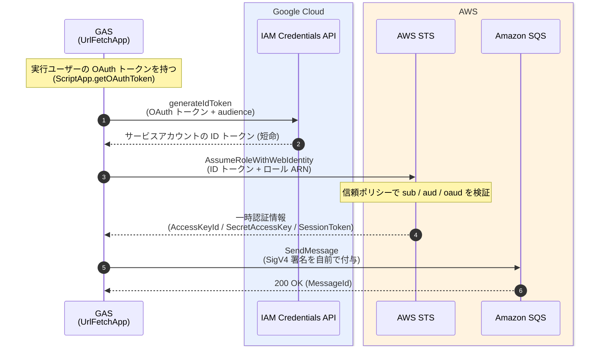
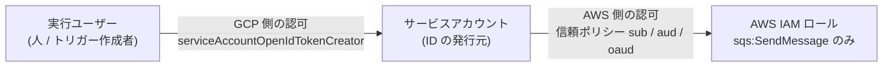

# GAS から AWS SQS へメッセージを送る方法（GCP サービスアカウント経由・長期キー不要）

Google Apps Script（GAS）から、**AWS のアクセスキーを持たずに** SQS へメッセージを送るための設定方法。
GCP のサービスアカウントで Google の IDトークンを発行し、AWS STS で一時認証情報に交換して SQS に送信する。

---

## 1. 全体像

GAS は **3 回** 通信する。「Google でユーザーを識別（認証）→ AWS で一時的な権限に交換 → SQS に送信」という流れ。



| ステップ | 通信先 | 渡すもの | 得るもの | 必要な設定 |
|---|---|---|---|---|
| ① ID トークン発行 | GCP IAM Credentials API | 実行ユーザーの OAuth トークン、`audience` | サービスアカウントの ID トークン | 手順 A（実行ユーザーへのロール付与）、手順 B（スコープ） |
| ② 一時認証情報に交換 | AWS STS | ID トークン、ロール ARN | 一時認証情報（有効期限あり） | 手順 D（信頼ポリシー付き IAM ロール） |
| ③ メッセージ送信 | AWS SQS | SigV4 署名付きリクエスト | `200 OK` と `MessageId` | 手順 D（`sqs:SendMessage` の許可ポリシー） |

### 認証・認可の境界



- **GCP 側**では、ログイン（認証）済みのユーザーに発行された OAuth トークンから「誰が呼んだか」を識別し、そのユーザーが `serviceAccountOpenIdTokenCreator` を持つかを IAM が**認可**する。サービスアカウントの ID トークンを作れるのは、この両方を通った人だけである。
- **AWS 側**は、信頼ポリシーでトークンの `sub`（サービスアカウントの数値 ID）、`azp`（`azp` がなければ `aud`）、`aud`（`generateIdToken` に渡した `audience`）を検証する。そのため、特定のサービスアカウントの、特定の audience 向けのトークンだけが通る。実行ユーザーが誰かは AWS からは見えない。

### 押さえておくポイント

| 項目 | 内容 |
|---|---|
| 長期キー | 不要（AWS のアクセスキーも、GCP のサービスアカウントキーも作らない） |
| AWS 側の ID プロバイダ登録 | **不要**。Google の OIDC プロバイダは AWS に組み込み済み（IAM の「ID プロバイダ」画面では何も作らない） |
| AWS SDK | GAS では使えない。`UrlFetchApp` で SQS の HTTP API を直接呼び、SigV4 署名を自前で行う（付録 A のコード） |
| 誰の権限で動くか | GAS を**実行したユーザー**（トリガー実行ならトリガーを作成したユーザー）の権限で、手順 (1) が評価される |
| AWS 側の認可 | ユーザーではなく、**サービスアカウントの ID**（`sub`）と**トークンの宛先**（`azp`、`aud`）で判定する。つまりサービスアカウントのトークンを作れる人は、全員が同じ SQS 送信権限を持つ |

---

## 2. 事前に決める値

作業前に、次の値を決めて控えておく。

| 名前 | 例 | 使う場所 |
|---|---|---|
| `GCP_PROJECT_ID` | `my-project` | GCP 全般 |
| `GCP_PROJECT_NUMBER` | `123456789012` | GAS の紐づけ（手順 B-1） |
| `SERVICE_ACCOUNT` | `gas-aws-bridge@my-project.iam.gserviceaccount.com` | GCP、GAS の `CONFIG` |
| `AUDIENCE` | `gas-to-aws`（任意の文字列） | GAS の `CONFIG`、AWS 信頼ポリシーの `oaud` |
| `AWS_ACCOUNT_ID` | `123456789012` | AWS 全般 |
| `REGION` | `ap-northeast-1` | GAS の `CONFIG` |
| `QUEUE_URL` | `https://sqs.ap-northeast-1.amazonaws.com/123456789012/my-queue` | GAS の `CONFIG` |
| `QUEUE_ARN` | `arn:aws:sqs:ap-northeast-1:123456789012:my-queue` | AWS 許可ポリシー |
| `ROLE_NAME` | `gas-sqs-sender` | AWS IAM ロール |
| `MESSAGE_GROUP_ID` | `gas` | FIFO キューの場合のみ |

---

## 3. 役割分担と必要な権限

| 担当 | 作業 | 必要な権限 |
|---|---|---|
| GCP 管理者 | API 有効化、サービスアカウント作成、権限付与 | API 有効化: Service Usage Admin（`serviceusage.services.enable`）／権限付与: そのサービスアカウントの Service Account Admin など |
| GAS 管理者 | スクリプトの設定・トリガー作成 | スクリプトの編集権限 |
| AWS 管理者 | IAM ポリシーとロールの作成 | IAM の作成権限 |
| GAS 実行者（人・トリガー作成者） | スクリプトの実行 | **手順 A-5 で付与するロール**（後述） |

---

## 4. 手順 A: GCP 側の準備

### A-1. GCP プロジェクトを決める

標準の GCP プロジェクトを選ぶか、新規に作る。**プロジェクト ID** と**プロジェクト番号**を控える。

### A-2. IAM Service Account Credentials API を有効化する

コンソールの場合:

1. [Google Cloud コンソール](https://console.cloud.google.com/)で A-1 のプロジェクトを選ぶ。
2. **「API とサービス」→「ライブラリ」** を開く。
3. **「IAM Service Account Credentials API」** を検索し、**「有効にする」** を押す。

コマンドの場合（Cloud Shell など）:

```bash
gcloud config set project YOUR_PROJECT_ID
gcloud services enable iamcredentials.googleapis.com
```

### A-3. サービスアカウントを作る

1. **「IAM と管理」→「サービスアカウント」→「サービスアカウントを作成」** を開く。
2. 名前を `gas-aws-bridge` などにして作成する。
3. **プロジェクトへのロール付与は不要**（トークンの発行元として使うだけ）。

### A-4. サービスアカウントの Unique ID を控える

AWS の信頼ポリシーで使う。

**UI で確認する場合**

1. 「IAM と管理」→「サービスアカウント」を開く。
2. 対象のサービスアカウントのメールアドレスをクリックする。
3. **「詳細（Details）」タブ**の **「Unique ID」** をコピーする。

**コマンドで確認する場合**

```bash
gcloud iam service-accounts describe SERVICE_ACCOUNT --format='value(uniqueId)'
```

> [!NOTE]
> 同じ名前でサービスアカウントを作り直すと、Unique ID は変わる。作り直した場合は AWS 側の信頼ポリシーも更新すること。

### A-5. GAS を実行するユーザーに、トークン発行の権限を付与する

**付与するロール:** `roles/iam.serviceAccountOpenIdTokenCreator`（表示名: Service Account OpenID Connect Identity Token Creator）

これは、IAM Credentials API の `generateIdToken` に必要な権限 `iam.serviceAccounts.getOpenIdToken` を含む。

**付与先（誰に付けるか）**

| 実行方法 | 付与が必要なユーザー |
|---|---|
| エディタから手動実行・メニュー実行 | 実行した本人 |
| 時間主導などのトリガー | **トリガーを作成したユーザー** |
| ウェブアプリ（実行ユーザー=自分） | デプロイした人 |
| ウェブアプリ（実行ユーザー=アクセスした人） | アクセスする全員 |

#### 定期実行（時間主導トリガー）など、人が操作しない実行の場合

トリガーによる実行では、実行時に人が操作しない。ただし、**実行はトリガーを作成したユーザーとして行われる**（Apps Script の公式ドキュメントの記述）。そのため、`generateIdToken` の権限は、そのユーザーのものとして判定される。

- ロールの付与先は、**実行時に操作する人ではなく、トリガーの作成者**である。作成者にロールが付いていないと、トリガー実行時に 403 になる。
- 作成者が別の人に変わると、付与先も変わる。トリガーを作り直した場合は、新しい作成者にもロールを付与する。
- 初回の承認画面（スコープの許可）は、トリガーの作成者が済ませておく必要がある。`oauthScopes` を追加・変更したときは、作成者がエディタから関数を手動実行して再承認する。再承認する前にトリガーが動くと、失敗する場合がある（「Authorization is required to perform that action」エラーの報告があるが、公式ドキュメントには明記されていない）。
- 運用上の注意（作成者は 1 人にする、アカウントが無効になるとトリガーが止まる）は、手順 E-3 を参照する。

> [!NOTE]
> サービスアカウント自身をトリガーの作成者にできるかどうかは、今回確認していない。この文書は、トリガーの作成者が人のアカウントである前提で書いている。

複数人で使う場合は、**Google グループ**に付与すると管理しやすい（`group:` で指定する）。ただし、グループのメンバー変更は反映に時間がかかる。

> [!NOTE]
> **実際に確認した事実:** プロジェクトの管理者系ロール（Owner や Service Account Admin）を持っていても、このロールを付与するまでは `getOpenIdToken` が拒否された。管理者権限があっても、**このロールの付与は必要**である。

**コマンドで付与する（確実な方法）**

```bash
# ユーザーに付与
gcloud iam service-accounts add-iam-policy-binding SERVICE_ACCOUNT \
  --member=user:実行ユーザーのメールアドレス \
  --role=roles/iam.serviceAccountOpenIdTokenCreator

# グループに付与
gcloud iam service-accounts add-iam-policy-binding SERVICE_ACCOUNT \
  --member=group:グループのメールアドレス \
  --role=roles/iam.serviceAccountOpenIdTokenCreator
```

**コンソールで付与する場合**

1. サービスアカウントの詳細ページで **「Principals with access」タブ**（または Permissions タブの「Principals with access to this service account」セクション）を開く。
2. 一覧のチェックボックスはすべて外す（チェックは既存権限の削除などの一括操作用）。
3. **「Grant access」** をクリックする。
4. **「Add principals」→「New principals」** に、**GAS を実行するユーザー（またはグループ）のメールアドレス**を入力する。
5. **「Assign roles」** で `Service Account OpenID Connect Identity Token Creator` を選び、**Save** する。

> [!CAUTION]
> **よくある間違い（重要）**
> Permissions タブには、**Principal 欄にサービスアカウント自身が最初から入っている画面**がある。これは「サービスアカウントが、プロジェクトの何に対して何をできるか」を設定する別の画面である。**ここでロールを付与しても、今回の目的には効かない**（不要な権限が付くだけ）。
> 入力するのは **GAS を実行する人** であり、サービスアカウント自身ではない。

**付与できたかの確認**

```bash
gcloud iam service-accounts get-iam-policy SERVICE_ACCOUNT
```

出力の `bindings` に、次の内容があれば成功。

```yaml
- members:
  - user:実行ユーザーのメールアドレス
  role: roles/iam.serviceAccountOpenIdTokenCreator
```

> [!NOTE]
> **反映待ち:** IAM の変更は即時には反映されない。通常 2 分程度、7 分以上かかることもある。グループのメンバー変更は、数分から数時間以上かかる場合がある。

> [!CAUTION]
> **付与してはいけないロール:** `roles/iam.serviceAccountTokenCreator` も `getOpenIdToken` を含むが、アクセストークンの発行など権限が広いため、今回は付けない（最小権限）。

---

## 5. 手順 B: GAS 側の設定

### B-1. スクリプトを標準 GCP プロジェクトに紐づける

1. Apps Script のエディタで、左の **「プロジェクトの設定」**（歯車）を開く。
2. **「Google Cloud Platform（GCP）プロジェクト」→「プロジェクトを変更」** を開き、A-1 の**プロジェクト番号**を入力する。

> [!CAUTION]
> - 既定のプロジェクトから標準プロジェクトへの切り替えは、**元に戻せない**。
> - スクリプトのオーナーの組織外のプロジェクトは指定できない場合がある。

### B-2. マニフェスト（`appsscript.json`）にスコープを追加する

1. 同じ「プロジェクトの設定」で、**「appsscript.json マニフェスト ファイルをエディタで表示する」** にチェックを入れる（この操作自体に保存は不要）。
2. 左の **「エディタ」** に戻ると、ファイル一覧に `appsscript.json` が表示される。
3. 開いて、次のように `oauthScopes` を追加し、**保存**する。

```json
{
  "timeZone": "Asia/Tokyo",
  "runtimeVersion": "V8",
  "exceptionLogging": "STACKDRIVER",
  "oauthScopes": [
    "https://www.googleapis.com/auth/cloud-platform",
    "https://www.googleapis.com/auth/script.external_request"
  ]
}
```

| スコープ | 必要な理由 |
|---|---|
| `cloud-platform` | IAM Credentials API（`generateIdToken`）を呼ぶため。公式には `iam` または `cloud-platform` のどちらかが必要 |
| `script.external_request` | `UrlFetchApp` で外部（GCP・AWS）へ通信するため |

**注意**

- `oauthScopes` を明示すると、**自動判定は行われなくなる**。このスクリプトで他のサービス（スプレッドシート、Gmail など）も使う場合は、そのスコープも追記すること。現在のスコープは、左の「概要」→「プロジェクトの OAuth スコープ」で確認できる。
- `iam` スコープに絞ることも公式には可能だが、GAS での動作は未検証。

### B-3. コードを貼り付けて `CONFIG` を設定する

付録 A の `Code.gs` を貼り付け、先頭の `CONFIG` を書き換える。

| 項目 | 設定する値 |
|---|---|
| `SERVICE_ACCOUNT` | サービスアカウントのメールアドレス（**サービスアカウントの詳細ページからコピー**するのが確実） |
| `AUDIENCE` | 手順 2 で決めた文字列（AWS の `oaud` と一致させる） |
| `ROLE_ARN` | 手順 D-4 で作るロールの ARN |
| `REGION` / `QUEUE_URL` | SQS のリージョンとキュー URL |
| `MESSAGE_GROUP_ID` / `FIFO_DEDUP` | **FIFO キュー（URL が `.fifo` で終わる）の場合のみ**使用（第 7 章） |

---

## 6. 手順 C: ID トークンの発行テスト（AWS 設定の前に必ず実施）

1. エディタで関数 `testIdToken` を選び、**実行**する。
2. 初回は承認画面が出るので許可する。
3. 「実行ログ」に次のような内容が出れば成功。**トークン本体は出力されない**（認証情報のため）。

```json
{
  "iss": "https://accounts.google.com",
  "sub": "（サービスアカウントの数値 ID）",
  "azp": "（数値 ID、またはメールアドレス）",
  "aud": "gas-to-aws",
  "email": "gas-aws-bridge@..."
}
```

**ここで `sub` と `azp` の値を控える。** AWS の信頼ポリシーに使う。

> [!IMPORTANT]
> **`azp` の値は実際に確認すること。** Google の公式例では `sub` と同じ数値 ID だが、資料によっては（サービスアカウントのトークンで）メールアドレスだったという記述もある。このログの実際の値を信頼ポリシーに使うこと。

| 結果 | 対応 |
|---|---|
| 403 `PERMISSION_DENIED`（`iam.serviceAccounts.getOpenIdToken`） | A-5 の権限が未付与、付与先が違う、または反映待ち。`get-iam-policy` で確認し、数分待って再実行 |
| API が有効でないというエラー | A-2 を確認 |
| 認可エラー | B-2 のスコープと保存を確認 |

---

## 7. 手順 D: AWS 側の設定

### D-1. ID プロバイダは登録しない

**IAM の「ID プロバイダ」画面では何も作成しない。** Google の OIDC プロバイダは AWS に組み込み済みである。ロールだけを作る。

### D-2. 許可ポリシーを作る（SQS 送信のみ）

IAM →「ポリシー」→「ポリシーを作成」→ JSON で、次を指定する。

```json
{
  "Version": "2012-10-17",
  "Statement": [
    {
      "Effect": "Allow",
      "Action": "sqs:SendMessage",
      "Resource": "arn:aws:sqs:REGION:AWS_ACCOUNT_ID:QUEUE_NAME"
    }
  ]
}
```

ポリシー名の例: `gas-sqs-send-policy`。**対象キューの ARN に限定**すること。

> [!NOTE]
> キューを KMS のカスタマー管理キーで暗号化している場合は、KMS の権限も必要になる可能性がある。この要件は今回確認していない。

### D-3. 信頼ポリシーを用意する

次の `<...>` に、手順 C で控えた値を入れる。

```json
{
  "Version": "2012-10-17",
  "Statement": [
    {
      "Effect": "Allow",
      "Principal": { "Federated": "accounts.google.com" },
      "Action": "sts:AssumeRoleWithWebIdentity",
      "Condition": {
        "StringEquals": {
          "accounts.google.com:sub": "<手順Cのsub>",
          "accounts.google.com:aud": "<手順Cのazp>",
          "accounts.google.com:oaud": "<AUDIENCEの値>"
        }
      }
    }
  ]
}
```

| 条件キー | 対応するトークンのクレーム |
|---|---|
| `accounts.google.com:sub` | `sub` |
| `accounts.google.com:aud` | **`azp`**（`azp` がなければ `aud`） |
| `accounts.google.com:oaud` | **`aud`**（`generateIdToken` に渡した `audience`） |

3 つとも指定して、**特定のサービスアカウントと、特定の audience だけ**を許可する。条件を省くと、意図しないトークンでもロールを引き受けられる可能性がある。

#### 補足: トークンの `sub`・`aud`・`azp` とは

OIDC（OpenID Connect）の ID トークンに入っている項目（クレーム）である。

| クレーム | 意味 | 今回の値 |
|---|---|---|
| `sub`（Subject） | トークンの持ち主を一意に表す ID | サービスアカウントの数値 ID |
| `aud`（Audience） | トークンの宛先（誰に向けたトークンか） | `generateIdToken` に渡した `audience`（例: `gas-to-aws`） |
| `azp`（Authorized party） | トークンの発行を受けた当事者の ID。省略されることがある | 数値 ID またはメールアドレス（手順 C のログで確認する） |

AWS の条件キーは名前が紛らわしい。`accounts.google.com:aud` は `azp` を、`accounts.google.com:oaud` は `aud` を見ている。

### D-4. IAM ロールを作る

1. IAM →「ロール」→「ロールを作成」を開く。
2. 信頼されたエンティティタイプは、**「カスタム信頼ポリシー」**を選ぶ。
   - 「ウェブ ID」のウィザードは、audience を `:aud` に入れてしまい、サービスアカウントのトークンと一致しないため使わない。
3. D-3 の信頼ポリシーを貼り付ける。
4. 許可ポリシーとして D-2 のポリシーをアタッチする。
5. ロール名（例: `gas-sqs-sender`）を付けて作成し、**ロール ARN** を控える。
6. GAS の `CONFIG.ROLE_ARN` にそのロール ARN を設定する。

---

## 8. 手順 E: 実行と運用

### E-1. 動作確認

1. `main` を実行する。
2. 成功すると、ログに HTTP ステータス `200` と `<SendMessageResponse>` を含む XML が出る。
3. SQS コンソールで、メッセージが届いていることを確認する。

### E-2. FIFO キューの場合

URL が `.fifo` で終わるキューでは、`MessageGroupId` が必須である。付録 A のコードは、URL が `.fifo` の場合に自動で付与する。

| 設定 | 意味 |
|---|---|
| `MESSAGE_GROUP_ID` | 同じグループ内は順序が保たれる。順序を分けないなら固定値で可 |
| `FIFO_DEDUP: 'uuid'`（既定） | 毎回ユニークな `MessageDeduplicationId` を付ける。**重複排除は働かない** |
| `FIFO_DEDUP: 'content'` | ID を付けない。**キュー側で「コンテンツベースの重複排除」が有効な場合のみ**使える（無効だとエラー） |

### E-3. 時間主導トリガー

1. 左の「トリガー」（時計アイコン）から `main` のトリガーを追加する。
2. **トリガーの作成者は 1 人に決める。** 複数人が作ると二重に実行される。
3. 作成者は、事前に A-5 の権限付与と、GAS の承認（スコープの許可）を済ませておく。
4. 作成者のアカウントが無効になるとトリガーが止まる。運用専用アカウントを作成者にする方法もある（任意の運用上の工夫）。

### E-4. 本番キューへの誤送信に注意

手動実行でも、同じ AWS ロール・同じキューに送信される。テストには、テスト用のキューを使うか、`CONFIG` を切り替えられるようにすること。

---

## 9. トラブルシューティング

| 症状 | 主な原因 | 対処 |
|---|---|---|
| `generateIdToken failed: 403 ... getOpenIdToken denied` | ロール未付与／付与先のアカウントが実行ユーザーと違う／反映待ち | `get-iam-policy` で実行ユーザーが載っているか確認。付与後は数分待つ |
| 同上で、Troubleshooter の Resource が `Unknown` | **Unknown 自体は異常とは限らない**。Principal（誰として評価されたか）と「Allow policy: Principal is missing permissions」の表示を確認する | Principal のアカウントに A-5 のロールを付与 |
| `Session.getEffectiveUser` で `userinfo.email` が不足 | 実行ユーザーの確認用コードを使った場合のみ。明示スコープに `userinfo.email` がない | 診断が必要な間だけ `userinfo.email` を追加。終わったら削除してよい（トークン発行には不要） |
| STS が `AccessDenied` / `InvalidIdentityToken` | 信頼ポリシーの `sub` / `aud` / `oaud` がトークンの実際の値と一致しない | 手順 C のログの値で信頼ポリシーを見直す |
| SQS が `SignatureDoesNotMatch` | リージョン、キュー URL、署名対象の不一致、端末時刻のずれなど | `CONFIG.REGION` と `QUEUE_URL` のホスト名が一致しているか確認 |
| SQS が `AccessDenied` | 許可ポリシーの `Resource`（キュー ARN）や `Action` の誤り | D-2 のポリシーを確認 |
| SQS が `MissingParameter: MessageGroupId` | FIFO キューに `MessageGroupId` なしで送信 | 付録 A（FIFO 対応済み）のコードを使う |
| FIFO で `FIFO_DEDUP: 'content'` なのにエラー | キューのコンテンツベース重複排除が無効 | `'uuid'` にするか、キュー側で有効化する |

---

## 10. 確認状況

### 実環境で確認できたこと（構築時）

- GAS から `generateIdToken` を呼んで ID トークンを発行できること（A-5 のロール付与後）
- AWS STS での交換が成功し、署名付きの SQS リクエストが SQS に到達すること（FIFO キューのパラメータ検証エラーが SQS から返った＝ここまでの経路は通っている）
- 管理者系ロールだけでは `getOpenIdToken` が拒否されること

### 検証したこと（コード）

- SigV4 署名の処理を、AWS 公式ライブラリ（botocore）の結果と比較し、**署名が一致する**ことを確認（日本語・記号を含む本文、FIFO / 標準キューの両方）。
- ID トークンのクレーム抽出処理（`testIdToken`）を、模擬環境で確認。
- いずれも模擬環境での確認であり、GAS 実環境そのものの確認ではない。

### 未確認のこと（実施する場合は各自で確認）

- FIFO 対応後の `main()` が成功し、SQS にメッセージが届くことの最終確認（**確認できたらこの欄を更新すること**）
- `iam` スコープだけで動作するか
- KMS 暗号化キューでの追加権限の要否
- Google 用に追加された AWS 側の追加条件キー（例: 組織番号など）の利用
- コンソールの画面文言（版や言語で異なる）

---

## 11. セキュリティ上の注意

| 項目 | 内容 |
|---|---|
| トークンは認証情報 | ID トークン・一時認証情報（特に `SecretAccessKey` / `SessionToken`）は、ログ、チャット、チケットに貼らない。`testIdToken()` はクレームのみ出力する |
| スクリプトの共有範囲 | GAS を編集できる人は、実行ユーザーの権限でトークンを発行するコードを書ける。**編集権限は最小限に** |
| 最小権限 | GCP は `serviceAccountOpenIdTokenCreator` のみ（`serviceAccountTokenCreator` や `Owner` に頼らない）。AWS は `sqs:SendMessage` を対象キューのみ |
| 信頼ポリシーの絞り込み | `sub`・`aud`・`oaud` をすべて指定する |
| 権限付与の影響範囲 | A-5 で付与した人・グループは、全員が SQS に送信できる。グループへの追加は慎重に |
| 監査 | GCP の監査ログ、AWS CloudTrail で、トークン発行・ロール引き受けを追跡できる |
| `Remediate` ボタン | Troubleshooter の「Remediate」は、対象を理解せずに押さない（意図しない広い権限の付与につながる可能性がある） |

---

## 12. 構築後の片付けチェックリスト

- [ ] 診断のために一時的に付けたロール（`serviceAccountTokenCreator` など）を外した
- [ ] 診断用のスコープ（`userinfo.email`）を `appsscript.json` から削除した
- [ ] 診断用の関数（`whoAmI` など）を削除した
- [ ] プロジェクトの IAM に、サービスアカウント自身への不要なロールが付いていない
- [ ] `CONFIG` にトークンや秘密情報を書き込んでいない
- [ ] トリガーの作成者を 1 人に決めた
- [ ] テスト用と本番用のキューを分けた

---

## 13. 参考資料

公式ドキュメント

- Google: [IAM Credentials API `generateIdToken`](https://docs.cloud.google.com/iam/docs/reference/credentials/rest/v1/projects.serviceAccounts/generateIdToken)
- Google: [Roles for service account authentication](https://docs.cloud.google.com/iam/docs/service-account-permissions)
- Google: [Manage access to service accounts](https://docs.cloud.google.com/iam/docs/manage-access-service-accounts)
- Google: [Access change propagation（IAM 変更の反映時間）](https://docs.cloud.google.com/iam/docs/access-change-propagation)
- Google: [Enable and disable services](https://docs.cloud.google.com/service-usage/docs/enable-disable)
- Google: [Install the gcloud CLI](https://cloud.google.com/sdk/docs/install)
- Apps Script: [Manifests](https://developers.google.com/apps-script/concepts/manifests) ／ [Authorization scopes](https://developers.google.com/apps-script/concepts/scopes) ／ [Google Cloud projects](https://developers.google.com/apps-script/guides/cloud-platform-projects)
- AWS: [Create an OIDC identity provider in IAM（Google は組み込み済みのため作成不要との記載）](https://docs.aws.amazon.com/IAM/latest/UserGuide/id_roles_providers_create_oidc.html)
- AWS: [Create a role for OIDC federation](https://docs.aws.amazon.com/IAM/latest/UserGuide/id_roles_create_for-idp_oidc.html)
- AWS: [AssumeRoleWithWebIdentity](https://docs.aws.amazon.com/STS/latest/APIReference/API_AssumeRoleWithWebIdentity.html)
- AWS: [SQS Query API リクエスト](https://docs.aws.amazon.com/AWSSimpleQueueService/latest/SQSDeveloperGuide/sqs-making-api-requests.html)
- AWS: [署名付き API リクエストの作成（SigV4）](https://docs.aws.amazon.com/general/latest/gr/sigv4-create-canonical-request.html)
- AWS: [AWS STS が Google などの IdP 固有クレームの検証に対応（What's New, 2026-01）](https://aws.amazon.com/about-aws/whats-new/2026/01/aws-sts-supports-validation-identity-provider-claims)

補助資料（公式ではない。内容は上記公式資料と照合のうえ参照）

- [DevelopersIO: AWS STS の OIDC フェデレーションにおけるプロバイダ固有クレーム検証（`aud`↔`azp`、`oaud`↔`aud` の対応表）](https://dev.classmethod.jp/en/articles/aws-sts-oidc-github-google-circleci-oci/)
- [jpassing: Authenticating to AWS by using a Google Cloud service account and AssumeRoleWithWebIdentity](https://jpassing.com/2021/10/05/authenticating-to-aws-by-using-a-google-cloud-service-account-and-assumerolewithwebidentity)
- [takesection-sandbox/gas-example（GAS から STS を呼ぶ実装例）](https://github.com/takesection-sandbox/gas-example)
- [AWS Developer Blog: How the Amazon SQS FIFO API Works](https://aws.amazon.com/blogs/developer/how-the-amazon-sqs-fifo-api-works)

---

## 付録 A: `Code.gs`（全文）

```javascript
/***** 設定値 *****/
const CONFIG = {
  SERVICE_ACCOUNT: 'gas-aws-bridge@my-project.iam.gserviceaccount.com',
  AUDIENCE: 'gas-to-aws',                       // AWS信頼ポリシーの accounts.google.com:oaud と一致させる
  ROLE_ARN: 'arn:aws:iam::123456789012:role/gas-sqs-sender',
  REGION: 'ap-northeast-1',
  QUEUE_URL: 'https://sqs.ap-northeast-1.amazonaws.com/123456789012/my-queue',
  // --- FIFOキュー（URLが .fifo で終わる場合）のみ使用。標準キューでは無視される ---
  MESSAGE_GROUP_ID: 'gas',   // 同じグループ内は順序が保証される。順序不要なら実行ごとに変えてもよい
  FIFO_DEDUP: 'uuid',        // 'uuid'：毎回ユニークID（重複排除なし） / 'content'：キューの ContentBasedDeduplication に任せる
};

function main() {
  const message = buildMessage_();
  const idToken = getGoogleIdToken_();
  const creds = assumeRoleWithWebIdentity_(idToken);
  // FIFOキューでは、メッセージIDを重複排除IDとして使う（FIFO_DEDUP が 'uuid' の場合）
  const result = sendSqsMessage_(creds, JSON.stringify(message), { dedupId: message.messageId });
  Logger.log(result);
}

/**
 * SQSに送るメッセージの組み立て。
 * ここは「注文作成イベント」の例。実際の用途に合わせて項目を置き換える。
 */
function buildMessage_() {
  const now = new Date();
  return {
    schemaVersion: '1.0',                         // 受信側がフォーマットの版を判別できるように
    messageId: Utilities.getUuid(),               // メッセージごとの一意なID（追跡・重複判定用）
    eventType: 'order.created',                   // イベントの種類
    source: 'gas',                                // 送信元
    scriptId: ScriptApp.getScriptId(),            // 送信元スクリプトの識別
    occurredAt: now.toISOString(),                // 発生時刻（UTC, ISO 8601）
    data: {
      orderId: 'ORD-' + Utilities.formatDate(now, 'Asia/Tokyo', 'yyyyMMdd-HHmmss'),
      customerId: 'C-10023',
      status: 'NEW',
      currency: 'JPY',
      items: [
        { sku: 'SKU-001', name: 'ノートパソコン用スタンド', quantity: 2, unitPrice: 3200 },
        { sku: 'SKU-014', name: 'USB-Cケーブル 1m', quantity: 3, unitPrice: 980 },
      ],
      totalAmount: 2 * 3200 + 3 * 980,            // 9340
      note: '午前中の配送を希望',
    },
  };
}

/**
 * 動作確認用：IDトークンを発行できるか確認し、AWS信頼ポリシーに必要なクレームだけをログに出す。
 * トークン本体（認証情報）はログに出さない。
 */
function testIdToken() {
  const token = getGoogleIdToken_();
  let payload = token.split('.')[1];
  while (payload.length % 4) payload += '=';
  const claims = JSON.parse(
    Utilities.newBlob(Utilities.base64DecodeWebSafe(payload)).getDataAsString()
  );
  Logger.log(JSON.stringify({
    iss: claims.iss, sub: claims.sub, azp: claims.azp, aud: claims.aud, email: claims.email,
  }, null, 2));
}

/** 1. サービスアカウントのIDトークンを発行（IAM Credentials API） */
function getGoogleIdToken_() {
  const url = 'https://iamcredentials.googleapis.com/v1/projects/-/serviceAccounts/' +
    CONFIG.SERVICE_ACCOUNT + ':generateIdToken';
  const res = UrlFetchApp.fetch(url, {
    method: 'post',
    contentType: 'application/json',
    headers: { Authorization: 'Bearer ' + ScriptApp.getOAuthToken() },
    payload: JSON.stringify({ audience: CONFIG.AUDIENCE, includeEmail: true }),
    muteHttpExceptions: true,
  });
  if (res.getResponseCode() !== 200) {
    throw new Error('generateIdToken failed: ' + res.getResponseCode() + ' ' + res.getContentText());
  }
  return JSON.parse(res.getContentText()).token;
}

/** 2. IDトークンをAWS一時認証情報に交換（AssumeRoleWithWebIdentity は署名不要） */
function assumeRoleWithWebIdentity_(idToken) {
  const body = formEncode_({
    Action: 'AssumeRoleWithWebIdentity',
    Version: '2011-06-15',
    RoleArn: CONFIG.ROLE_ARN,
    RoleSessionName: 'gas-session',
    WebIdentityToken: idToken,
  });
  const res = UrlFetchApp.fetch('https://sts.amazonaws.com/', {
    method: 'post',
    contentType: 'application/x-www-form-urlencoded',
    payload: body,
    muteHttpExceptions: true,
  });
  if (res.getResponseCode() !== 200) {
    throw new Error('STS failed: ' + res.getResponseCode() + ' ' + res.getContentText());
  }
  const ns = XmlService.getNamespace('https://sts.amazonaws.com/doc/2011-06-15/');
  const c = XmlService.parse(res.getContentText())
    .getRootElement()
    .getChild('AssumeRoleWithWebIdentityResult', ns)
    .getChild('Credentials', ns);
  return {
    AccessKeyId: c.getChildText('AccessKeyId', ns),
    SecretAccessKey: c.getChildText('SecretAccessKey', ns),
    SessionToken: c.getChildText('SessionToken', ns),
  };
}

/** 3. SQS SendMessage（Query API, SigV4署名） */
function sendSqsMessage_(creds, messageBody, options) {
  const m = CONFIG.QUEUE_URL.match(/^https:\/\/([^\/]+)(\/.*)$/);
  const host = m[1];
  const path = m[2];
  const params = {
    Action: 'SendMessage',
    Version: '2012-11-05',
    MessageBody: messageBody,
  };
  // FIFOキュー（URLが .fifo で終わる）は MessageGroupId が必須
  if (/\.fifo$/.test(path)) {
    params.MessageGroupId = CONFIG.MESSAGE_GROUP_ID;
    // 'content' 以外なら、毎回ユニークな重複排除IDを付ける
    if (CONFIG.FIFO_DEDUP !== 'content') {
      params.MessageDeduplicationId = (options && options.dedupId) || Utilities.getUuid();
    }
  }
  const body = formEncode_(params);
  const headers = signV4_({
    method: 'POST', host: host, path: path, service: 'sqs',
    region: CONFIG.REGION, body: body, creds: creds, now: new Date(),
  });
  const res = UrlFetchApp.fetch(CONFIG.QUEUE_URL, {
    method: 'post',
    contentType: 'application/x-www-form-urlencoded',
    payload: body,
    headers: headers,
    muteHttpExceptions: true,
  });
  return { code: res.getResponseCode(), body: res.getContentText() };
}

/***** SigV4 署名 *****/
function signV4_(p) {
  const amzDate = Utilities.formatDate(p.now, 'UTC', "yyyyMMdd'T'HHmmss'Z'");
  const dateStamp = amzDate.substring(0, 8);
  const signedHeaders = 'host;x-amz-date;x-amz-security-token';

  const canonicalRequest = [
    p.method,
    p.path,
    '',                                   // クエリ文字列なし（パラメータはbody）
    'host:' + p.host,
    'x-amz-date:' + amzDate,
    'x-amz-security-token:' + p.creds.SessionToken,
    '',
    signedHeaders,
    sha256Hex_(p.body),
  ].join('\n');

  const scope = dateStamp + '/' + p.region + '/' + p.service + '/aws4_request';
  const stringToSign = ['AWS4-HMAC-SHA256', amzDate, scope, sha256Hex_(canonicalRequest)].join('\n');

  let key = hmac_(bytes_('AWS4' + p.creds.SecretAccessKey), dateStamp);
  key = hmac_(key, p.region);
  key = hmac_(key, p.service);
  key = hmac_(key, 'aws4_request');
  const signature = toHex_(hmac_(key, stringToSign));

  // Host ヘッダーは UrlFetchApp が自動付与するため、ここには含めない
  return {
    'x-amz-date': amzDate,
    'x-amz-security-token': p.creds.SessionToken,
    Authorization: 'AWS4-HMAC-SHA256 Credential=' + p.creds.AccessKeyId + '/' + scope +
      ', SignedHeaders=' + signedHeaders + ', Signature=' + signature,
  };
}

/***** ヘルパー *****/
function enc_(s) {
  return encodeURIComponent(s).replace(/[!'()*]/g, function (c) {
    return '%' + c.charCodeAt(0).toString(16).toUpperCase();
  });
}
function formEncode_(obj) {
  return Object.keys(obj).map(function (k) { return enc_(k) + '=' + enc_(obj[k]); }).join('&');
}
function bytes_(s) { return Utilities.newBlob(s).getBytes(); }
function hmac_(keyBytes, msg) { return Utilities.computeHmacSha256Signature(bytes_(msg), keyBytes); }
function sha256Hex_(s) {
  return toHex_(Utilities.computeDigest(Utilities.DigestAlgorithm.SHA_256, s, Utilities.Charset.UTF_8));
}
function toHex_(bytes) {
  return bytes.map(function (b) { return ('0' + (b & 0xff).toString(16)).slice(-2); }).join('');
}
```

## 付録 C: 送信するメッセージの形式（サンプル）

`Code.gs` の `buildMessage_()` は、次のような JSON を SQS の本文として送る。**中身は「注文作成イベント」の例**なので、実際の用途に合わせて置き換えること（送信側の `buildMessage_()` と、受信側の読み取り処理の項目名を揃える）。

```json
{
  "schemaVersion": "1.0",
  "messageId": "36545e29-c8fb-45a4-a7b4-110d5cf252b4",
  "eventType": "order.created",
  "source": "gas",
  "scriptId": "（GASのスクリプトID）",
  "occurredAt": "2026-10-30T12:34:56.000Z",
  "data": {
    "orderId": "ORD-20261030-213456",
    "customerId": "C-10023",
    "status": "NEW",
    "currency": "JPY",
    "items": [
      { "sku": "SKU-001", "name": "ノートパソコン用スタンド", "quantity": 2, "unitPrice": 3200 },
      { "sku": "SKU-014", "name": "USB-Cケーブル 1m", "quantity": 3, "unitPrice": 980 }
    ],
    "totalAmount": 9340,
    "note": "午前中の配送を希望"
  }
}
```

| 項目 | 目的 |
|---|---|
| `schemaVersion` | 受信側が形式の版を判別できるようにする（後から項目を変えやすくなる） |
| `messageId` | メッセージごとの一意な ID。追跡や、受信側での重複判定に使う。FIFO キューでは重複排除 ID としても使う |
| `eventType` | イベントの種類。受信側の処理の振り分けに使う |
| `source` / `scriptId` | 送信元の識別 |
| `occurredAt` | 発生時刻（UTC, ISO 8601） |
| `data` | イベントの本体。用途ごとに自由に設計する |

**設計上の注意**

- SQS のメッセージには**サイズの上限**がある（この文書では確認していない。大きなデータは本文に入れず、保存先の参照だけを送る設計も検討すること）。
- **個人情報や機密情報は、できるだけ本文に入れない**こと。受信側のログ（CloudWatch Logs など）に残ることがある。
- 標準キューは同じメッセージが複数回届くことがある。受信側は、`messageId` などで**重複しても問題ない作り**にすること。

## 付録 B: コマンドまとめ（GCP 側）

Cloud Shell（コンソール右上の `>_`）、または gcloud を認証済みの端末で実行する。

```bash
# 変数
PROJECT_ID=YOUR_PROJECT_ID
SA=gas-aws-bridge@${PROJECT_ID}.iam.gserviceaccount.com
USER_EMAIL=実行ユーザーのメールアドレス

gcloud config set project "$PROJECT_ID"

# A-2: API 有効化
gcloud services enable iamcredentials.googleapis.com

# A-3: サービスアカウント作成
gcloud iam service-accounts create gas-aws-bridge --display-name="GAS to AWS bridge"

# A-4: Unique ID の確認
gcloud iam service-accounts describe "$SA" --format='value(uniqueId)'

# A-5: 権限付与（実行ユーザーごと、またはグループに）
gcloud iam service-accounts add-iam-policy-binding "$SA" \
  --member=user:"$USER_EMAIL" \
  --role=roles/iam.serviceAccountOpenIdTokenCreator

# 付与の確認
gcloud iam service-accounts get-iam-policy "$SA"
```

### gcloud を Mac にインストールする場合（Cloud Shell を使わないとき）

```bash
brew install --cask gcloud-cli   # Homebrew を使う場合（古い資料では cask 名が google-cloud-sdk）
gcloud --version
gcloud auth login                # ブラウザで GCP のアカウントにログイン
gcloud config set project YOUR_PROJECT_ID
```

Homebrew を使わない場合は、[公式のインストールページ](https://cloud.google.com/sdk/docs/install)からアーカイブを入手し、`./google-cloud-sdk/install.sh` と `./google-cloud-sdk/bin/gcloud init` を実行する。
