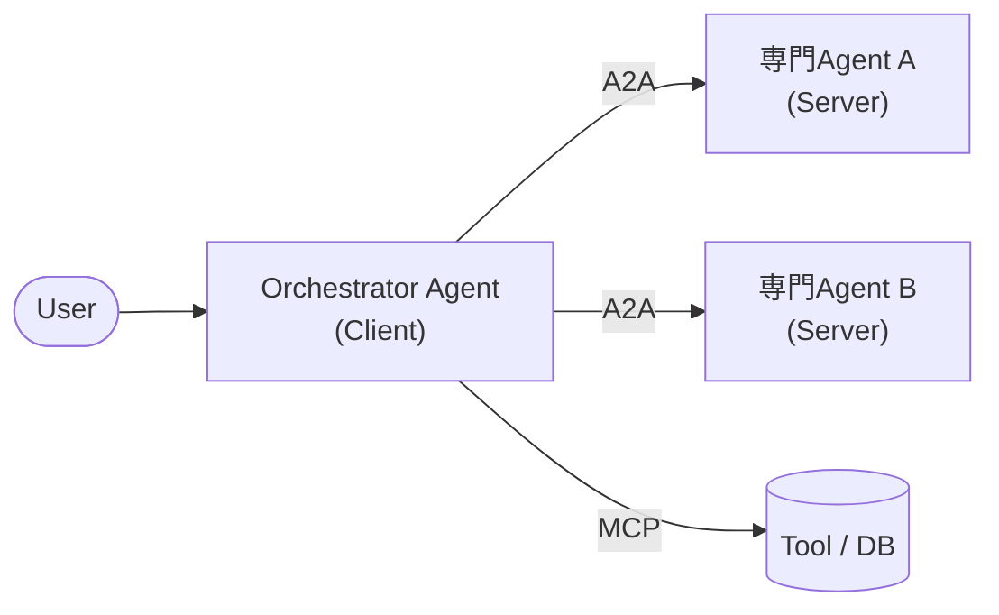
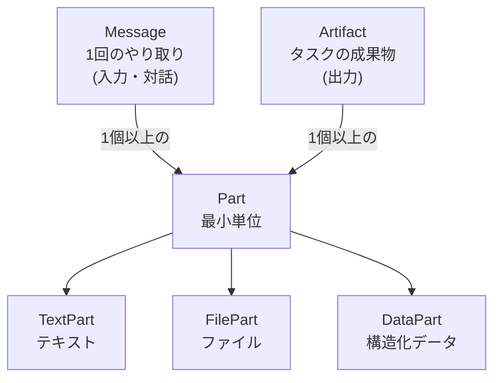
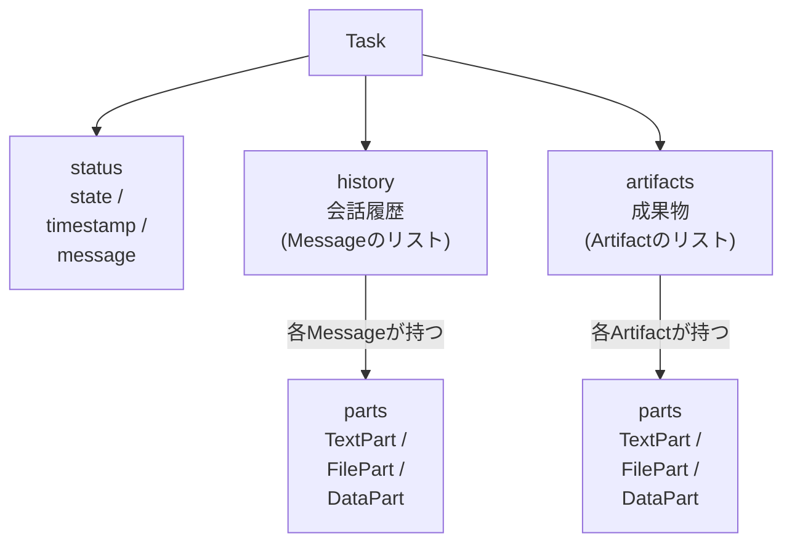
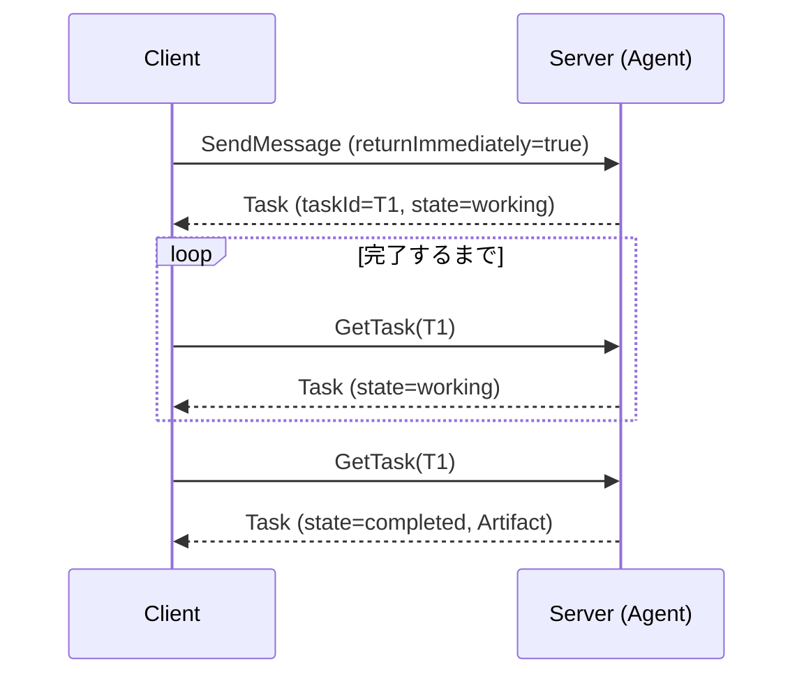
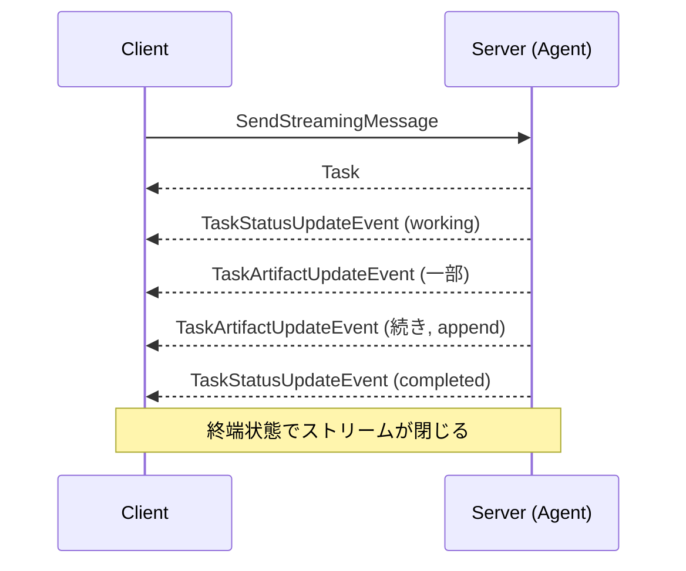
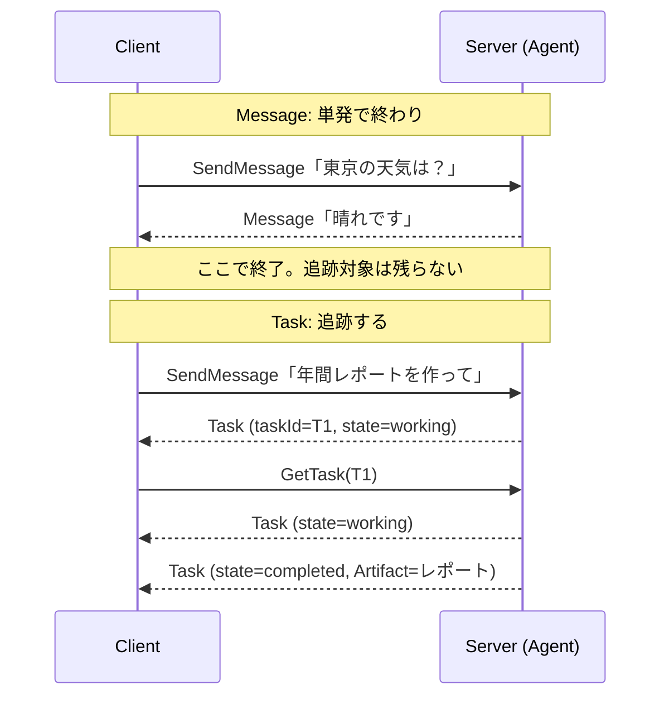
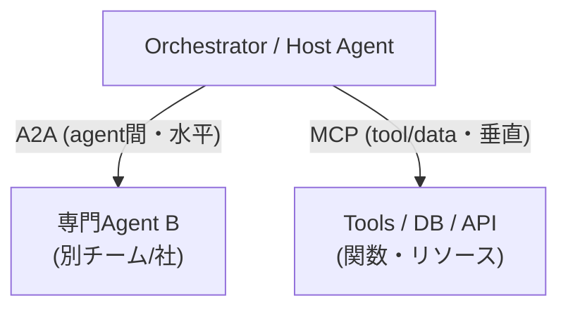

# 概要

> [!TIP]
> Python SDK (`a2a-sdk`) で実際に開発する場合は、別ノート **[A2A SDK開発ガイド (Python).md](A2A%20SDK開発ガイド%20(Python).md)** を参照 (インストール、サーバ/クライアント実装、状態管理、永続化、Push通知、認証、テストなど。動作確認済みのコード付き)。このノートは概念の整理が中心。

**A2A (Agent2Agent) Protocol** は、異なるフレームワーク・ベンダー・組織で作られた **AIエージェント同士を相互接続 (interoperability) するためのオープンプロトコル**。

- **2025年4月9日**に Google が発表 (Google Cloud Next 2025 での発表と報じられている。Google の公式ブログ本文には会場の記載なし)。50社以上のパートナー (Atlassian, Salesforce, SAP, ServiceNow, MongoDB, LangChain, Cohere 等) が参加。
- **2025年6月23日** (Open Source Summit North America) に **Linux Foundation** へ寄贈され、ベンダー中立のオープンガバナンスに移行。創設メンバーは AWS, Cisco, Google, Microsoft, Salesforce, SAP, ServiceNow。**2026年8月27日に Agentic AI Foundation (AAIF) の Growth Stage プロジェクト**として受け入れられた。AAIF の公式ブログによると、150を超える組織が A2A を支持している。
- **2026年3月12日に v1.0 が公開** (現行の安定版)。コアデータモデル/プロトコルバインディングが安定化。**v0.3 → v1.0 で wire フォーマットに破壊的変更**あり (メソッド名・Partのエンコード・AgentCardのインターフェース宣言など。詳細は後述の「バージョン (v0.3 → v1.0)」)。ただし **AgentCard は後方互換**に進化し、各 `supportedInterfaces` 要素で `protocolVersion` を指定して v0.3/v1.0 両対応を宣言できるため、段階移行が可能。
- 位置としては **「エージェント間 (agent ↔ agent) の水平連携」** のための標準。MCP が「エージェント ↔ ツール/データ (垂直方向)」を担うのに対し、A2A は「エージェント ↔ エージェント (水平方向)」を担う (詳細は本ノート下部の「MCP との関係・使い分け」セクションを参照)。

> 一言でいうと: **「エージェント版のHTTP/REST」**。異なる中身のエージェントを、共通の話し方 (JSON-RPC / gRPC / REST) でつなぐ。

> [!IMPORTANT]
> **本ノートの表記方針**: 概念説明は **v1.0 を基準**に、随所で **v0.3 (legacy) の名称も併記**する。Python の `a2a-sdk` サンプルコードは **最新の 1.x 系 (1.2.2, 2026-10-05) の API** で記載 (`create_client` / `Message`+`Part` / `TaskUpdater` 等)。v0.3スタイル (`A2AClient` / `MessageSendParams` / `{"kind":"text"}`) は現在 `a2a.compat.v0_3` 配下の後方互換（SDK の `enable_v0_3_compat=True` フラグで対応）。実装時は使用する `a2a-sdk` / 対象エージェントの `supportedInterfaces[].protocolVersion` を必ず確認すること。

---

# バージョンと互換性 (v0.3 → v1.0)

v1.0 (2026-03-12) で **JSON表現 (wire フォーマット) に破壊的変更**が入った。仕様は3層構造 (**Layer 1**: Protocol Buffers によるコアデータ定義 / **Layer 2**: 能力・振る舞い / **Layer 3**: 具体的バインディング = JSON-RPC・gRPC・HTTP+JSON) で整理され、JSON-RPCのメソッド名などが Layer 1 の proto 定義に揃えられた。

主な変更点:

| 項目 | v0.3 (legacy) | v1.0 (current) |
|------|--------------|----------------|
| JSON-RPCメソッド名 | `message/send`, `tasks/get`, `tasks/cancel` … | `SendMessage`, `GetTask`, `CancelTask` … (PascalCase, proto準拠) |
| リクエスト型名 | `MessageSendParams` | `SendMessageRequest` |
| TextPart | `{"kind":"text","text":"..."}` | `{"text":"..."}` (メンバの有無で判別) |
| FilePart | `{"kind":"file","file":{...}}` | `{"raw":"...", "filename":"...", "mediaType":"..."}` (or `url`) |
| DataPart | `{"kind":"data","data":{...}}` | `{"data":{...}, "mediaType":"application/json"}` |
| ストリームイベント | `{"kind":"status-update", ...}` | `{"statusUpdate":{...}}` / `{"artifactUpdate":{...}}` |
| AgentCardのインターフェース宣言 | `url` + `preferredTransport` + `additionalInterfaces` | `supportedInterfaces` 配列 (先頭が優先。各要素に `protocolBinding`/`protocolVersion`) |
| 拡張カードの対応可否 | top-level `supportsAuthenticatedExtendedCard` | `capabilities.extendedAgentCard` |
| 拡張カード取得メソッド | `agent/getAuthenticatedExtendedCard` | `GetExtendedAgentCard` |

> [!NOTE]
> - legacy名は **プロトコル仕様の移行付録に記載**されており、SDK の `enable_v0_3_compat=True` と `a2a.compat.v0_3` モジュールで後方互換を提供。
> - 互換は **各 `supportedInterfaces` 要素の `protocolVersion` フィールド**で宣言し、クライアントは `A2A-Version` ヘッダ等でネゴシエートする。v0.3/v1.0 両対応なら複数要素を並べる。
> - 以降の各節では、まず概念を述べ、必要な箇所で「v0.3では〜」と注記する。

---

# なぜ必要か (背景)

現実の業務は複数の専門エージェントの協調で成り立つが、以下の課題があった。

- エージェントごとに **フレームワークがバラバラ** (LangGraph, CrewAI, ADK, AutoGen, Semantic Kernel...)
- ベンダー・クラウド・社内/社外の **境界を越えた連携が困難**
- 各社が独自プロトコルを作ると **N×Nの組み合わせ爆発** が起きる

A2A は共通の「話し方」を決めることで、**エージェントを内部実装を晒さずにブラックボックスのまま連携** させられる。

## 設計原則 (Design Principles)

| 原則 | 内容 |
|------|------|
| **Agentic-first** | エージェントを「ツール」ではなく、状態・記憶・自律性を持つ対等な存在として扱う。共有メモリやツールを前提としない。 |
| **Build on existing standards** | HTTP, JSON-RPC 2.0, Server-Sent Events (SSE) など既存Web標準の上に構築 |
| **Secure by default** | エンタープライズ級の認証・認可 (OpenAPI Auth 相当) を前提に設計 |
| **Support long-running tasks** | 数秒〜数時間・数日かかる非同期タスク、human-in-the-loop に対応 |
| **Modality agnostic** | テキストだけでなく、音声・映像・ファイル・構造化データ (フォーム等) を扱える |
| **Opaque execution** | エージェントは内部の思考・プラン・ツールを公開せず、宣言した能力ベースで協調する |

---

# 主要な登場人物 (Core Concepts)

## Client Agent と Remote Agent (A2A Server)

- **Client Agent (Client)**: タスクを依頼する側。ユーザーの代理として動く。
- **Remote Agent / A2A Server**: 依頼を受けて処理する側。A2Aの HTTP エンドポイントを公開する。

同じエージェントが状況によって Client にも Server にもなり得る (役割は固定ではない)。



## Agent Card (エージェントの「名刺」)

エージェントの能力・接続情報を記述した **JSON メタデータ**。A2A連携の出発点。

- 慣例的な公開場所: **`https://<host>/.well-known/agent-card.json`** (Well-Known URI 方式)
  - ※初期仕様では `/.well-known/agent.json` だったが、後に `agent-card.json` に変更された。
- 記載される主な内容:
  - `name`, `description`, `version`, `provider`
  - `supportedInterfaces` (v1.0。URL+transportの組の一覧、先頭が優先) ／ v0.3では `url` + `preferredTransport`
  - **`capabilities`**: `streaming` (SSE対応), `pushNotifications` (webhook対応), `extendedAgentCard` (認証後に詳細版カードを返せるか) 等の対応可否
  - **`skills`**: このエージェントが提供する能力の一覧 (id, name, description, tags, examples, 入出力modality, スキル単位の `securityRequirements`)
  - **`securitySchemes` / `securityRequirements`**: 認証方式 (OAuth2, API Key, OpenID Connect 等)
  - `defaultInputModes` / `defaultOutputModes`: 対応する入出力形式 (text/plain, application/json 等)
  - `signatures` (署名付きカード), `documentationUrl`, `iconUrl` (いずれも任意)
  - ※対応するA2Aバージョンは AgentCard 直下ではなく、**`supportedInterfaces[].protocolVersion`** で宣言する (v0.3/v1.0 両対応なら要素を並べる)

**v1.0 スタイル** (`supportedInterfaces` + `capabilities.extendedAgentCard`):

```json
{
  "name": "Weather Agent",
  "description": "天気予報を提供するエージェント",
  "version": "1.0.0",
  "supportedInterfaces": [
    { "url": "https://weather.example.com/a2a/v1", "protocolBinding": "JSONRPC", "protocolVersion": "1.0" }
  ],
  "capabilities": {
    "streaming": true,
    "pushNotifications": true,
    "extendedAgentCard": true
  },
  "defaultInputModes": ["text/plain"],
  "defaultOutputModes": ["text/plain", "application/json"],
  "securitySchemes": {
    "oauth2": {
      "oauth2SecurityScheme": {
        "flows": {
          "authorizationCode": {
            "authorizationUrl": "https://oauth.example.com/authorize",
            "tokenUrl": "https://oauth.example.com/token",
            "scopes": { "weather.read": "Read weather data" }
          }
        }
      }
    }
  },
  "securityRequirements": [
    {
      "schemes": {
        "oauth2": { "list": ["weather.read"] }
      }
    }
  ],
  "skills": [
    {
      "id": "get_forecast",
      "name": "天気予報取得",
      "description": "指定地域の天気予報を返す",
      "tags": ["weather", "forecast"],
      "examples": ["東京の明日の天気は？"],
      "securityRequirements": [
        {
          "schemes": {
            "oauth2": { "list": ["weather.read"] }
          }
        }
      ]
    }
  ]
}
```

> [!NOTE]
> **v0.3 (legacy) との差**: v0.3では `supportedInterfaces` の代わりに top-level `"url"` + `"preferredTransport": "JSONRPC"`、`extendedAgentCard` の代わりに top-level `"supportsAuthenticatedExtendedCard": true` を書いていた。後方互換のため当面は旧フィールドも解決可能。

### Agent Discovery (A2Aサーバの見つけ方・使い方)

クライアントがリモートエージェントを使うまでの流れは「**① Agent Card を手に入れる → ② Card を読んで使えるか判断する → ③ Card に書かれた接続先へリクエストする**」。①の入手方法(発見)が3通りある (仕様書 §8.2 / 公式 `topics/agent-discovery`)。

| 方式 | 進め方 | 向いている場面 | 注意点 |
|---|---|---|---|
| **① Well-Known URI** | ドメインが分かっている相手に `GET https://{domain}/.well-known/agent-card.json` | 公開エージェント、特定ドメイン内で広く見つけてほしいエージェント | 標準パスなので自動発見しやすい。機微な情報を含む Card は、このエンドポイント自体に認証をかけるか、拡張 Agent Card (認証後に詳細を返す) に分ける |
| **② Curated Registry (カタログ)** | レジストリに「こういうスキルを持つエージェント」と問い合わせ、一致する Agent Card (またはその参照) を返してもらう | 企業内の一元管理、公開マーケットプレイス。スキルでの検索、アクセス制御、ガバナンス | レジストリの構築・運用が必要。**現行仕様はレジストリの標準APIを定めていない** |
| **③ Direct Configuration** | 設定ファイル・環境変数・ハードコードで Agent Card の URL (または Card 自体) を直接渡す | 密結合な社内システム、private なエージェント、開発・テスト | 動的な発見はできない。Card が変わるたびにクライアント側の設定変更が必要 |

**Agent Card を手に入れたあと、クライアントが見るもの**

| Card のフィールド | クライアントがすること |
|---|---|
| `skills` / `description` | そのエージェントに頼める内容か判断する (LLM に渡して委譲先を選ばせる使い方が多い) |
| `capabilities.streaming` | `true` のときだけ `SendStreamingMessage` / `SubscribeToTask` を使う |
| `capabilities.pushNotifications` | `true` のときだけ Push通知を登録する |
| `capabilities.extendedAgentCard` | `true` なら認証後に `GetExtendedAgentCard` で詳細版を取れる |
| `supportedInterfaces[]` | **接続先と通信方式の候補**。`url` / `protocolBinding` (`JSONRPC` / `GRPC` / `HTTP+JSON`) / `protocolVersion` / `tenant`。先頭が優先で、クライアントは自分が話せるものを選ぶ |
| `securitySchemes` / `securityRequirements` | どの認証方式・スコープが必要か。トークンを取得してから呼ぶ |
| `defaultInputModes` / `defaultOutputModes`、スキルごとの `inputModes` / `outputModes` | 送れる/返ってくるメディアタイプ |
| `signatures` | 署名があれば検証して、改ざん・なりすましを防ぐ |

**キャッシュ** (仕様書 §8.6)
- サーバは Agent Card の HTTP 応答に `Cache-Control` (`max-age`) と `ETag` を付けるべき(SHOULD)。`Last-Modified` は任意(MAY)。
- クライアントは HTTP キャッシュの規則 (RFC 9111) に従い、期限切れなら `If-None-Match` / `If-Modified-Since` の条件付きリクエストで再取得するべき(SHOULD)。変わっていなければ `304` が返る。
- 実機確認 (a2a-sdk 1.2.2): `ETag` が付き、`If-None-Match` で再取得すると `304` が返った。ただし `Cache-Control` は既定では付かない (`create_agent_card_routes(cache_control=...)` で指定する)。

**公開版と認証後の版を分ける**
- 公開してよい最小限の情報は well-known に、詳細(内部向けスキル・内部URLなど)は **拡張 Agent Card** (`GetExtendedAgentCard`、要認証) に置く。公式も「機微な情報は拡張 Agent Card にすることを推奨」している。
- そのほか、Agent Card の配信エンドポイントに mTLS / ネットワーク制限 / HTTP認証をかける、レジストリが相手の権限に応じて返す Card を変える(選択的開示)、という守り方がある。

> [!NOTE]
> SDK でのコード(`create_client` が Card を自動取得する仕組み、`A2ACardResolver`、取得済み Card を渡す方法)は **[A2A SDK開発ガイド (Python).md](A2A%20SDK開発ガイド%20(Python).md)** の「Agent Card の取得と利用」を参照。

**サンプルコード (Python, a2a-sdk 1.2.2)**

##### 方式①：Well-Known URI（最も簡単）

###### Client 側：自動取得

```python
from a2a.client import create_client

# パターン1: 標準パス /.well-known/agent-card.json から自動取得
client = await create_client("http://localhost:9999")

# パターン2: カスタムパスから取得
client = await create_client(
    "http://localhost:9999",
    relative_card_path="/api/agent/card.json"
)

# パターン3: 認証ヘッダ付きで取得
client = await create_client(
    "http://localhost:9999",
    resolver_http_kwargs={"headers": {"Authorization": "Bearer my-token"}}
)

# パターン4: Card を検査してから使う（より詳しい制御）
import httpx
from a2a.client.card_resolver import A2ACardResolver

async with httpx.AsyncClient() as http:
    resolver = A2ACardResolver(
        httpx_client=http,
        base_url="http://localhost:9999"
    )
    card = await resolver.get_agent_card()
    
    # Card の内容に応じた処理分け
    if card.capabilities.streaming:
        print("ストリーミング対応")
    if card.capabilities.push_notifications:
        print("Push通知対応")
    
    # Card を使ってクライアント作成
    client = await create_client(card)
```

###### Server 側：自動公開

```python
from fastapi import FastAPI
from a2a.server.routes import create_agent_card_routes, create_jsonrpc_routes
from a2a.server.agent_execution import AgentExecutor, RequestContext
from a2a.server.events import EventQueue
from a2a.server.tasks import TaskUpdater, InMemoryTaskStore
from a2a.types import AgentCard, AgentInterface, AgentCapabilities, AgentSkill, Part

app = FastAPI()

# Agent Card の定義
agent_card = AgentCard(
    name="Echo Agent",
    description="テキストを返すエージェント",
    version="1.0.0",
    supported_interfaces=[
        AgentInterface(
            url="http://localhost:9999/",
            protocol_binding="JSONRPC",
            protocol_version="1.0"
        )
    ],
    capabilities=AgentCapabilities(streaming=True),
    default_input_modes=["text/plain"],
    default_output_modes=["text/plain"],
    skills=[
        AgentSkill(id="echo", name="Echo", description="テキストを返す")
    ]
)

# AgentExecutor 実装
class EchoExecutor(AgentExecutor):
    async def execute(self, context: RequestContext, event_queue: EventQueue) -> None:
        from a2a.helpers import new_task_from_user_message
        
        task = context.current_task or new_task_from_user_message(context.message)
        if not context.current_task:
            await event_queue.enqueue_event(task)
        
        updater = TaskUpdater(event_queue, task.id, task.context_id)
        text = context.get_user_input()
        
        await updater.complete(updater.new_agent_message([Part(text=f"Echo: {text}")]))
    
    async def cancel(self, context: RequestContext, event_queue: EventQueue) -> None:
        updater = TaskUpdater(event_queue, context.task_id, context.context_id)
        await updater.cancel()

# ルート生成
card_routes = create_agent_card_routes(
    agent_card=agent_card,
    cache_control="public, max-age=300"  # キャッシュ設定
)
app.include_router(card_routes)

task_store = InMemoryTaskStore()
jsonrpc_routes = create_jsonrpc_routes(
    agent_executor=EchoExecutor(),
    task_store=task_store
)
app.include_router(jsonrpc_routes)

# /.well-known/agent-card.json で自動公開
```

テスト：
```bash
# Server 起動
python server.py

# 別ターミナルで Agent Card を取得
curl http://localhost:9999/.well-known/agent-card.json | jq .
```

##### 方式③：Direct Configuration（社内・テスト向け）

###### Client 側：設定 / ハードコード

```python
from a2a.client import create_client
from a2a.types import AgentCard, AgentInterface, AgentCapabilities, AgentSkill

# パターン1: ハードコード
card = AgentCard(
    name="Local Echo Agent",
    description="ローカルエージェント",
    version="1.0.0",
    supported_interfaces=[
        AgentInterface(
            url="http://localhost:9999/",
            protocol_binding="JSONRPC",
            protocol_version="1.0"
        )
    ],
    capabilities=AgentCapabilities(streaming=True),
    default_input_modes=["text/plain"],
    default_output_modes=["text/plain"],
    skills=[AgentSkill(id="echo", name="Echo", description="テキストを返す")]
)
client = await create_client(card)

# パターン2: JSON 設定から読み込み
import json
config = json.load(open("agent_card.json"))

card = AgentCard(
    name=config["name"],
    description=config["description"],
    version=config["version"],
    supported_interfaces=[
        AgentInterface(
            url=iface["url"],
            protocol_binding=iface["protocol_binding"],
            protocol_version=iface["protocol_version"]
        )
        for iface in config["supported_interfaces"]
    ],
    capabilities=AgentCapabilities(**config["capabilities"]),
    default_input_modes=config["default_input_modes"],
    default_output_modes=config["default_output_modes"],
    skills=[
        AgentSkill(id=sk["id"], name=sk["name"], description=sk["description"])
        for sk in config["skills"]
    ]
)
client = await create_client(card)

# パターン3: 環境変数から URL を読み込み
import os
agent_url = os.environ.get("A2A_AGENT_URL", "http://localhost:9999/")

card = AgentCard(
    name="Environment-based Agent",
    version="1.0.0",
    supported_interfaces=[
        AgentInterface(
            url=agent_url,
            protocol_binding="JSONRPC",
            protocol_version="1.0"
        )
    ],
    capabilities=AgentCapabilities(streaming=True),
    default_input_modes=["text/plain"],
    default_output_modes=["text/plain"],
)
client = await create_client(card)
```

###### Server 側：カスタムエンドポイント

```python
from fastapi import FastAPI
from google.protobuf.json_format import MessageToDict
from a2a.server.routes import create_jsonrpc_routes
from a2a.types import AgentCard

app = FastAPI()

agent_card = AgentCard(...)

# JSON カスタムエンドポイント
@app.get("/api/agent/card.json")
async def get_agent_card():
    return MessageToDict(agent_card)

# または Well-Known URI も並行して提供
from a2a.server.routes import create_agent_card_routes
card_routes = create_agent_card_routes(agent_card=agent_card)
app.include_router(card_routes)
```

テスト：
```bash
# カスタムパスから取得
curl http://localhost:9999/api/agent/card.json | jq .

# Well-Known URI からも取得可
curl http://localhost:9999/.well-known/agent-card.json | jq .
```

**3つの方式の比較**

| 方式 | Client コード | Server コード | キャッシュ | 動的発見 |
|------|--------------|--------------|----------|--------|
| ① Well-Known | `create_client(url)` で自動取得 | `create_agent_card_routes()` で自動生成 | ✓ ETag / Cache-Control | ✓ |
| ③ Direct | Card をハードコード / 設定から読み込み | カスタムエンドポイント (`@app.get()`) | △ (手動実装) | ✗ |

> [!NOTE]
> 方式②（Curated Registry）は現行仕様で標準 API が定められていないため、具体的なレジストリサービスが存在しない場合の実装例は省略。企業が独自実装する場合は、レジストリクライアント → `create_client(card)` の流れになる。

## Task (タスク) ― 状態を持つ作業単位
https://a2a-protocol.org/latest/topics/life-of-a-task/

A2Aのやり取りの中心。**一意の `id` を持ち、ライフサイクル (状態機械) を持つ**。

主なステータス (`TaskState`):

| 状態 | 意味 |
|------|------|
| `submitted` | 受付済み、未着手 |
| `working` | 処理中 |
| `input-required` | 追加入力待ち (human-in-the-loop / clarification) |
| `auth-required` | 認証が必要 |
| `completed` | 正常完了 (**終端状態**) |
| `canceled` | キャンセル (**終端**) |
| `failed` | エージェントが実行を試みたが、途中でエラー発生。例: API呼び出し失敗、タイムアウト、内部例外 (**終端**) |
| `rejected` | エージェントが「そのタスクは実行しない」と判断して受け付けなかった。例: 対応範囲外、ポリシー違反、リクエスト内容が不適切 (**終端**) |
| `unknown` | 不明 (wire上は `TASK_STATE_UNSPECIFIED`) |

> [!NOTE]
> **wire形式（proto enum値）** (v1.0):
> - `submitted` → `TASK_STATE_SUBMITTED`
> - `working` → `TASK_STATE_WORKING`
> - `input-required` → `TASK_STATE_INPUT_REQUIRED`
> - `auth-required` → `TASK_STATE_AUTH_REQUIRED`
> - `completed` → `TASK_STATE_COMPLETED`
> - `canceled` → `TASK_STATE_CANCELED`
> - `failed` → `TASK_STATE_FAILED`
> - `rejected` → `TASK_STATE_REJECTED`
> - `unknown` → `TASK_STATE_UNSPECIFIED`

**`rejected` と `failed` の違い:**
- **`rejected`**: 実行前に拒否。エージェントが「こういう依頼には応じられない」と判断して、最初から受け付けない。
- **`failed`**: 実行途中のエラー。エージェントが処理を始めたが、途中で失敗した。

- 長時間タスク・非同期タスクを表現でき、`input-required` を経由して人間や別エージェントとの往復ができる。
- 同一タスク内で会話を継続する場合は `contextId` でセッション/文脈をグルーピングする。

## Message / Part / Artifact

まず **Part が「中身の最小単位」** であり、**Message と Artifact はどちらも「1つ以上の Part の集まり」** として作られる、という包含関係。

- **Part**: コンテンツの最小単位。**マルチモーダル対応の要**。以下の3種類 (proto上は1つの `Part` の `oneof` で text/file/data を表す)。**v1.0ではメンバの有無で種別を判別**し、**v0.3では `kind` フィールドで判別**していた。
  - `TextPart` (テキスト) — v1.0: `{"text":"..."}` / v0.3: `{"kind":"text","text":"..."}`
  - `FilePart` (ファイル: bytes(base64)またはURI) — v1.0: `{"raw":"...", "filename":"...", "mediaType":"..."}` (or `url`) / v0.3: `{"kind":"file","file":{...}}`
  - `DataPart` (構造化JSONデータ。フォーム入力・構造化出力など) — v1.0: `{"data":{...}, "mediaType":"application/json"}` / v0.3: `{"kind":"data","data":{...}}`
- **Message**: Client と Agent の間の**1回のやり取り (1通のメッセージ)**。`role` は `ROLE_USER` (wire値) または `ROLE_AGENT` (wire値)。中身は Part の集まり (テキスト＋ファイル等を混在可能)。v0.3では `role: "user"` と文字列だったが、v1.0では enum値に変わった。
- **Artifact**: タスクの**成果物** (生成されたファイル・レポート・構造化結果など)。こちらも中身は Part の集まり。

> つまり **Part は Message と Artifact に共通の「部品」**。「Artifactの一部がPart」であると同時に「Messageの一部もPart」。



これを Task 全体の構造で見ると次のようになる。



**Task の中に Message は含まれる**。Task の構造のうち、Message が入るのは次の2か所 (仕様 §4.1.1 / §4.1.2 / §3.7)。

```
Task
├─ id / contextId
├─ status
│   ├─ state（working, input-required など）
│   └─ message（状態に添える Message）            ← ① Message が入る
├─ artifacts（成果物）                             ← Message ではなく Artifact が入る
└─ history（Task 内でやり取りした Message の一覧）  ← ② Message が入る
```

| 場所 (Task 内のフィールド) | 内容 |
|---|---|
| ① `Task.status.message` | 現在のステータスに添える Message。進捗の連絡や、`input-required` での追加入力の依頼などに使う |
| ② `Task.history` | Task 実行中にやり取りした Message の一覧 (`role` は `user` / `agent` の両方があり得る) |

一方、**Task の出力 (成果物) は Message ではなく `artifacts` に入れて返す**のが仕様上の想定。

> [!WARNING]
> `history` に全 Message が残る保証はない。一時的な情報メッセージや、Task 作成前のメッセージは保存されないことがあり、どれを残すかはエージェントの判断。クライアントは、事前に合意がない限り `history` に依存してはいけない。Message は重要情報の確実な配信手段とみなさず、重要な結果は Artifact で受け取る。

---

# 通信の仕組み (Transport & Protocol)

## トランスポート

A2A の公式トランスポート (protocol binding) は以下の **3種類** (仕様上の値は `JSONRPC` / `GRPC` / `HTTP+JSON`):

| トランスポート (値) | 用途 |
|-------------|------|
| **JSON-RPC 2.0** (`JSONRPC`, HTTP POST) | 標準・最も一般的。1リクエスト=1メソッド呼び出し |
| **gRPC** (`GRPC`) | 高性能・型付き。Protocol Buffers |
| **HTTP+JSON / REST** (`HTTP+JSON`) | REST風のインターフェース |

- **v1.0**: Agent Card は **`supportedInterfaces`** 配列で対応方式を宣言する。各要素は `{ url, protocolBinding, protocolVersion }` で、**先頭が優先**。
  - **v0.3 (legacy)**: `url` + `preferredTransport` (単一の推奨) + `additionalInterfaces` (追加の組) という別々のフィールドだった。
- **SSE (Server-Sent Events)** はトランスポートの一種ではなく、上記トランスポート上で **ストリーミング応答を配送する仕組み** (`SendStreamingMessage` / 旧 `message/stream` 等で使用。後述)。

## 主要メソッド (RPC Methods)

以下はすべて **A2A Server (Remote Agent) が公開し、Client が呼び出す (＝サーバが受信する) メソッド** で、方向は一貫して **Client → Server**。**メソッド名は v1.0 (PascalCase) を主に、括弧内に v0.3 (legacy) 名を併記**。

> [!NOTE]
> 例外的に **実際のPush通知 (webhookへのHTTP POST) だけは Server → Client** で、これはメソッドではないためこの表には含まれない (`CreateTaskPushNotificationConfig` は「通知先の登録」なのでサーバ受信)。

| メソッド (v1.0 / v0.3) | 役割 |
|---------|------|
| `SendMessage` (旧 `message/send`) | メッセージを送りタスクを作成/継続 (同期・単発レスポンス) |
| `SendStreamingMessage` (旧 `message/stream`) | メッセージ送信 + **SSEでストリーミング**受信 (要 `streaming` capability) |
| `GetTask` (旧 `tasks/get`) | タスクの現在状態・結果をポーリング取得 |
| `ListTasks` | タスク一覧の取得 |
| `CancelTask` (旧 `tasks/cancel`) | タスクのキャンセル要求 |
| `SubscribeToTask` (旧 `tasks/resubscribe`) | 切断後にSSEストリームへ再購読 |
| `CreateTaskPushNotificationConfig` (旧 `tasks/pushNotificationConfig/set`) | Push通知 (webhook) の設定 (登録/更新) |
| `GetTaskPushNotificationConfig` (旧 `tasks/pushNotificationConfig/get`) | Push通知設定の取得 |
| `ListTaskPushNotificationConfigs` (旧 `tasks/pushNotificationConfig/list`) | Push通知設定の一覧取得 |
| `DeleteTaskPushNotificationConfig` (旧 `tasks/pushNotificationConfig/delete`) | Push通知設定の削除 |
| `GetExtendedAgentCard` (旧 `agent/getAuthenticatedExtendedCard`) | 認証後の拡張Agent Card取得 |

> [!IMPORTANT]
> ### ■ 「メソッドごとに別エンドポイント」ではない (トランスポート次第)
> - **JSON-RPC** (最も一般的): 
>    - **単一エンドポイント** (例 `POST /`)。どのメソッドかは **body の `"method": "SendMessage"`** で指定し、サーバ側でディスパッチする。URLはメソッドごとに分けない。ストリーミングも同じ口でSSE。
> - **gRPC**: 
>    - 1つのgRPCサービスのメソッドとして呼ぶ。
> - **HTTP+JSON / REST**:
>    - **操作ごとに別パス** (`POST /message:send`, `GET /tasks/{id}`, `POST /tasks/{id}:cancel`, `GET /extendedAgentCard` …)。
>    - **RESTだけは「メソッド≒パス」**。
>
> ### ■ JSON-RPC前提なら、サーバが公開するのは基本この2エンドポイントだけ
> | # | エンドポイント | 役割 |
> |---|---|---|
> | 1 | `GET /.well-known/agent-card.json` | **Discovery** (Agent Card配信) |
> | 2 | `POST /` (JSON-RPCの口) | **やり取り全部** (`SendMessage`/`GetTask`/`CancelTask`/`ListTasks`/push設定CRUD/`GetExtendedAgentCard` … を **bodyの `method` でディスパッチ**) |
>
> 補足:
> - **ストリーミング (`SendStreamingMessage`) も②と同じパス**。レスポンスが **SSE (`text/event-stream`)** になるだけでパスは増えない。
> - **`GetExtendedAgentCard` (認証後の詳細カード) も②のメソッド**。①はあくまで「無認証で読ませる公開カード」。
> - **Push通知の“通知そのもの”はサーバの口ではない**: 完了時に **サーバがクライアントの webhook を叩く** (outbound)。増えるとしたら**クライアント側の受け口**。
> - ①も厳密には必須ではない (カードを out-of-band で渡すなら省ける) が、**well-known 配信が標準**なので実務上は2つ。
>
> ### ■ どのバインディングで公開するかも a2a-sdk で選べる(JSON-RPCが既定・最も一般的)
> - `create_jsonrpc_routes(...)` → **JSON-RPC** (単一エンドポイント)
> - `create_rest_routes(...)` → **REST (HTTP+JSON)** (操作ごとの別パス)
> - `create_agent_card_routes(...)` → Agent Card 配信 / `add_a2a_routes_to_fastapi(...)` → FastAPIに載せる補助
>
> ### ■ 実装の手間
> - **a2a-sdk を使う場合**: 
>   - 上記の `create_*_routes` が**ルーティングを自動生成**。さらに `DefaultRequestHandler` が `GetTask`/`CancelTask`/`ListTasks` などを **`TaskStore` で既定実装**し、`SendMessage`/streaming だけを **あなたの `AgentExecutor.execute()`** に委譲する。→ **実質 `execute()` と `cancel()` を書くだけ**。
> - **SDKを使わず自前でラップする場合** (素のLangChain/LangGraphを公開): 
>    - JSON-RPCなら **エンドポイントは1つでよく**、body の `method` を見て自分でディスパッチする。ただし **Agent Card配信 + 宣言した `capabilities` の各メソッドの中身** (レスポンス型の整形・SSE・エラーコード等) は全部自前で実装が必要。全メソッド必須ではなく **`capabilities` で宣言した範囲だけ**でよいが、手間が大きいので **a2a-sdk でのラップが実務上おすすめ**。

## 3つのインタラクションパターン

結果をどう受け取るかの違い。**「待つ / 聞きに行く」「流してもらう」「通知してもらう」** のどれを使うか、という整理。

| パターン | 受け取り方 | 使うメソッド | 向いている処理 |
|---|---|---|---|
| **1. Request/Response** (同期・ポーリング) | 結果が返るまで待つ。時間がかかるなら、後から状態を**聞きに行く** (ポーリング) | `SendMessage` + `GetTask` | 短い処理、完了まで待てる処理 |
| **2. Streaming (SSE)** | 接続を開いたまま、サーバが進捗・成果物を**逐次流す** | `SendStreamingMessage` (要 `streaming` capability) | 進捗や生成途中の内容をリアルタイムに見せたい処理 |
| **3. Push Notifications (Webhook)** | 接続を切っておき、状態が変わったらサーバが**通知してくる** | `CreateTaskPushNotificationConfig` + webhook | 数時間〜数日かかる処理 |

### 1. Request/Response (同期・ポーリング)
`SendMessage` (旧 `message/send`) で送信し、短時間タスクなら即結果が返る。長時間なら `GetTask` (旧 `tasks/get`) で状態をポーリング。



#### ポーリングの実装の要点

```
SendMessage(returnImmediately=true) → Task(id, state=submitted)
  └ ループ:
       GetTask(id)
       ├ 終端状態 (completed / failed / canceled / rejected) → 終了。結果を取り出す
       ├ 中断状態 (input-required / auth-required)            → ループを抜け、ユーザー入力/認証を促す
       └ それ以外 (submitted / working)                       → 間隔を空けて再度 GetTask
```

- **終了条件を必ず「終端状態 + 中断状態」の両方にする**。`input-required` を終端と思い込まずにループし続けると、永遠に待つことになる。
- **間隔は固定ではなく、徐々に伸ばす(バックオフ)** のが無難 (例: 1秒 → 2秒 → 4秒 ... 上限30秒)。サーバへの負荷と、結果が出るまでの遅れのバランスをとる。
- **全体のタイムアウト**を設ける。上限を超えたら `CancelTask` するか、諦めて利用者に伝える。
- 履歴が不要なら `GetTask` に `historyLength=0` を付けて、応答を軽くできる。
- 実機確認 (a2a-sdk 1.2.2): `return_immediately=True` で開始した直後は `SUBMITTED`、0.5秒間隔の `GetTask` を6回繰り返して `COMPLETED` になり、成果物も取得できた。SDK のコードは [A2A SDK開発ガイド (Python).md](A2A%20SDK開発ガイド%20(Python).md) の「ポーリング」を参照。
- 注意: ポーリングは**途中経過(`working` の間に出た成果物の断片)を一件ずつは追えない**。見えるのはその時点のスナップショットだけ。

### 2. Streaming (SSE)
`SendStreamingMessage` (旧 `message/stream`) を使い、**Server-Sent Events** で進捗を逐次push。1回のリクエストのレスポンスが `text/event-stream` になり、複数のイベントが流れてくる (仕様 §3.1.2)。

流れ方は2通り。
- **Message のみ:** `Message` を1つ流してすぐ閉じる。
- **Task のライフサイクル:** 最初に `Task` を流し、続けて `TaskStatusUpdateEvent` / `TaskArtifactUpdateEvent` を0個以上流す。終端状態に達したら閉じる。

#### `StreamResponse` のイベント種別

ストリームで流れる1件1件は **`StreamResponse`** で、次の4つのうち**ちょうど1つ**を持つ (`oneof`)。Push通知の webhook のボディも同じ形。

| フィールド (JSON) | 中身 | いつ流れるか |
|---|---|---|
| `task` | `Task` 全体のスナップショット | Task ライフサイクルの**最初の1件**。`SubscribeToTask` では、購読開始時点の現在の状態 |
| `message` | `Message` | Message-only の応答(Task を作らない)、または Task 内の途中メッセージ |
| `statusUpdate` | `TaskStatusUpdateEvent` (`taskId` / `contextId` / `status{state, message, timestamp}`) | 状態が変わるたび (`working` → `completed` など)。`status.message` に説明文を載せられる |
| `artifactUpdate` | `TaskArtifactUpdateEvent` (`taskId` / `contextId` / `artifact` / `append` / `lastChunk`) | 成果物が生成されるたび。大きな成果物を**断片で**流せる |

**ストリームの形(仕様上、次のどちらか。MUST)**
1. **Message-only**: `message` が**ちょうど1件**流れて、すぐ閉じる。Task の追跡や更新はない。
2. **Task ライフサイクル**: **最初に `task`**、続いて `statusUpdate` / `artifactUpdate` が0件以上。Task が**終端状態**(`completed` / `failed` / `canceled` / `rejected`)か**中断状態**(`input-required` / `auth-required`)になったらストリームが閉じる。実装は、閉じる前に最終の `task` スナップショットを再送してもよい(MAY)。

**`artifactUpdate` の `append` / `lastChunk`**

| フィールド | 意味 (`a2a.proto` のコメントより) |
|---|---|
| `append = true` | この内容を、**以前に送った同じ `artifactId` の成果物に追記**する |
| `append = false` / 未設定 | 追記ではない(新しい成果物として扱う) |
| `lastChunk = true` | この成果物の**最後の断片** |

クライアントは、同じ `artifactId` の断片を `append = true` の順に連結して組み立て、`lastChunk = true` で完成とする (実機では、`append=False` の1個目に続いて `append=True` の断片が届き、最後に `last_chunk=True` が届いた)。同じ `artifactId` を `append = false` で再度送った場合の扱い(置き換えか否か)は、仕様に明記がなく未確認。

**クライアントでの受け取り方(分岐の骨格)**

```python
async for ev in client.send_message(SendMessageRequest(message=msg)):
    kind = ev.WhichOneof("payload")
    if kind == "task":            # 最初の1件。task.id / task.context_id を保存しておく(再購読に使う)
        ...
    elif kind == "status_update": # state の変化
        ...
    elif kind == "artifact_update":
        ...                       # artifact_id ごとに parts を連結。last_chunk で完成
    elif kind == "message":       # Message-only、または途中メッセージ
        ...
```

#### ストリームが切れたとき (再接続と取りこぼし)

SSE は接続が切れると、**切れている間の更新は届かない**。復旧は次の手順。

```
接続が切れた
  │ (task.id は最初の `task` イベントで保存しておく)
  ▼
① GetTask(id) で現在の状態を確認
  │   ├ 終端状態(completed / failed ...) → 完了。GetTask の結果が最終結果
  │   └ 進行中 / 中断状態 ↓
  ▼
② SubscribeToTask(id) で再購読
      └ 最初に必ず「現在の Task」が届く → 切断中に進んだ分(成果物・状態)はここに含まれる
      └ 以降の差分を受け取り続ける
```

- **再購読すると、最初のイベントは必ず現在の `Task`**(仕様書 §3.1.6)。これは、`GetTask` と `SubscribeToTask` の間にある隙間で情報を失わないための仕様。
- 実機確認 (a2a-sdk 1.2.2): 成果物を 6 個に分けて送るタスクで、3個目まで受信して切断 → 1秒後に再購読 → 最初の `task` に `chunk0〜chunk3` までの成果物が入っており、続きとして `chunk4`、`chunk5`、`COMPLETED` が届いた。**取りこぼしなし**(ただし、このSDKは再購読時の `task` に成果物を載せる実装。仕様上の保証ではない)。
- 注意:
  - **終端状態の Task は購読できない**(`UnsupportedOperationError`)。復旧は `GetTask` で確認する。
  - `input-required` の Task を購読すると、最初に `task` が届くだけで、**ストリームは開いたまま**だった(実機確認)。中断状態で閉じるのは「`SendStreamingMessage` で開始したストリーム」で、後から購読したストリームではない点に注意。
  - 仕様上、ストリームの**途中メッセージ(`statusUpdate.status.message` など)は信頼できる配送手段ではない**。切断中のメッセージは再購読では復元されないことがある。エージェントが履歴に残す保証もない(MUST NOT rely)。**重要な結果は `Message` ではなく `Artifact` で返す**。
  - 複数のクライアントが同じ Task を購読してもよい(仕様上、各ストリームは同じイベントを同じ順序で受け取る)。
  - SSE には `Last-Event-ID` のような「ここから再開」の仕組みは仕様にない。再開は `SubscribeToTask` で行う。



切断された場合は `SubscribeToTask` (旧 `tasks/resubscribe`) で同じ Task のストリームに再購読できる(詳細な手順は上の「ストリームが切れたとき」)。

### 3. Push Notifications (Webhook / 非同期・切断耐性)
数時間〜数日かかるタスク向け。クライアントが常時接続を保てない場合に使う。
- クライアントが webhook URL を登録 (`CreateTaskPushNotificationConfig` / 旧 `tasks/pushNotificationConfig/set`)
- タスク完了/状態変化時に、サーバーがその URL へ HTTP POST で通知
- webhook 側は署名検証等でなりすましを防ぐ (後述のセキュリティ参照)

#### Push通知の仕組みと、受信側(クライアント)の責務

**流れ**

```
① クライアントが webhook URL を登録
     (a) SendMessage の configuration.taskPushNotificationConfig に入れる(Task ID は空)
     (b) 既存 Task に CreateTaskPushNotificationConfig
② サーバが Task を処理し、更新が起きるたびに webhook へ HTTP POST
③ クライアント(webhook 受信側)が検証して 2xx を返す
④ 通知を受けたら、必要なら GetTask で最新状態を取り直す
```

**登録する内容 (`TaskPushNotificationConfig`)**

| フィールド | 内容 |
|---|---|
| `url` (必須) | 通知の送り先。**HTTPS 推奨** |
| `token` | 受信側が「自分が登録した通知か」を確認するための値 |
| `authentication` | サーバが通知に付ける認証情報(`scheme` + `credentials`) |
| `id` / `taskId` | 設定の識別子 / 対象 Task |

**通知(POST)の中身** (仕様書 §4.3.3)
- ボディは **`StreamResponse` と同じ形**(`task` / `message` / `statusUpdate` / `artifactUpdate` のうち**ちょうど1つ**)。ストリームで流れるものと同じイベントが届く。
- 認証は、登録された `authentication` に従ってヘッダに付く(例: `Authorization: Bearer <credentials>`)。
- 実機確認 (a2a-sdk 1.2.2): `Authorization: Bearer abc123` と `X-A2A-Notification-Token: <登録したtoken>` が付き、ボディは `task` → `statusUpdate` → `artifactUpdate` → `statusUpdate` の順に届いた。**`X-A2A-Notification-Token` は仕様書に定義がない SDK 独自のヘッダ名**(仕様書は `token` を「Task/セッション固有のトークン」とするだけで、どう運ぶかは規定していない)。他の実装では別の方法で渡ってくる可能性がある。**`Content-Type` は `application/json`**(仕様書の例は `application/a2a+json`。SDK 1.2.2 は `application/json` で送っていた)。受信側は両方を受け付けるようにしておく。

**サーバの保証(送る側)**
- 設定された webhook に**最低1回は配信を試みる**(MUST)。
- 失敗時の**再試行(指数バックオフ)は任意**(MAY)。連続失敗で**諦めてもよい**(MAY)。タイムアウトは10〜30秒が推奨(SHOULD)。
- → **「必ず届く」保証はない**。重要な処理は、通知を待つだけでなく `GetTask` で確認する仕組みも持つ。

**受信側(クライアント)の責務**

| 責務 | 強さ | 内容 |
|---|---|---|
| **2xx で即応答** | MUST | 受信を確認したことを HTTP 2xx で返す。重い処理は応答後に非同期で行う |
| **認証の検証** | MUST | 登録した `authentication` / `token` と一致するか確認し、一致しなければ 401 |
| **Task ID の照合** | SHOULD | 通知の `taskId` が、自分が作った Task のものか確認する |
| **冪等な処理** | SHOULD | 同じ通知が**重複して届く**ことがある。二重に処理しても結果が変わらないようにする |
| **レート制限** | SHOULD | webhook への大量送信(フラッディング)対策 |
| **HTTPS を使う** | SHOULD | 通信内容の盗聴防止 |
| **トークンは単一用途で** | SHOULD | 設定ごとに専用のトークンを使い、定期的に更新する |

**サーバ側の責務(SSRF 対策)**: クライアントが登録する URL にサーバがリクエストを送るため、サーバは内部アドレス(`127.0.0.0/8`、`10.0.0.0/8`、`172.16.0.0/12`、`192.168.0.0/16`、`localhost`、リンクローカル)への送信を拒否するべき(SHOULD)。

**受信側の落とし穴(実機で踏んだ点)**
- **Task ID を事前に知れないことがある**: `SendMessage` の応答を受け取る前に、最初の通知が webhook に届くことがある(実機で、Task ID を応答から記録する方式だと最初の2通が「未知のタスク」になった)。受信側は「未知のタスクIDなら即拒否」と決めつけず、`contextId` や、登録時に自分で決めた相関ID(`token` に埋め込む、`metadata` を使うなど)で照合する。
- **順序・重複を前提にしない**: ストリームには「生成順に届ける」(MUST)という規定があるが、**Push通知にはその規定が書かれていない**。一方、重複配信は仕様上あり得る。通知の内容は鵜呑みにせず、`GetTask` で最新状態を取り直すのが安全(上記の実機では順序どおりに届いたが、それが保証されるわけではない)。

SDK の実装例(サーバ側の送信設定と、受信側の webhook サーバ)は [A2A SDK開発ガイド (Python).md](A2A%20SDK開発ガイド%20(Python).md) の「Push 通知」を参照。

### どれを選ぶか

| 状況 | 選ぶもの |
|---|---|
| 数秒で終わる | Request/Response (そのまま待つ) |
| 少し長いが、完了だけ分かればよい | Request/Response + ポーリング |
| 進捗や生成途中のトークンを画面に出したい | Streaming |
| 接続を保てない / 数時間以上かかる | Push Notifications (+ 必要なら `GetTask`) |

> [!NOTE]
> ポーリングは独立したモデルではなく、Request/Response で長時間処理を扱うときの受け取り方。`GetTask` / Push通知は `Task` に対する仕組みなので、エージェントが `Message` だけを直接返す場合は使いどころがない (`returnImmediately` も効かない)。Streaming は `Message` を1つ流して閉じるパターンもある。

### 3つの比較表 (Task の状態を知る方法)

「Task の状態をどう知るか」という観点で、3つを1つの表にまとめる。

| 観点 | ① ポーリング | ② SSE (Streaming) | ③ Push通知 (Webhook) |
|---|---|---|---|
| **一言でいうと** | クライアントが**聞きに行く** | サーバが**流し続ける** | サーバが**呼びに来る** |
| **使うメソッド** | `SendMessage` (`returnImmediately=true`) → `GetTask` を繰り返す | `SendStreamingMessage` (新規)、`SubscribeToTask` (既存Taskへの購読・再接続) | `CreateTaskPushNotificationConfig` で登録 (`SendMessage` の `configuration.taskPushNotificationConfig` で同時登録も可) |
| **通信の向き** | Client → Server (毎回リクエスト) | Server → Client (1本のHTTPレスポンスの中で複数イベント) | **Server → Client** (サーバがクライアントの webhook URL へ HTTP POST) |
| **接続** | リクエストごとに切れる | **張りっぱなし** (`text/event-stream`) | 常時接続なし (クライアントは webhook を受ける口を持つ) |
| **届くもの** | 都度 `Task` の最新スナップショット | 最初に `Task`、続いて `TaskStatusUpdateEvent` / `TaskArtifactUpdateEvent` (差分)。**途中経過・成果物の断片も届く** | `StreamResponse` 形式 (`task` / `message` / `statusUpdate` / `artifactUpdate` のいずれか1つ) をPOST |
| **リアルタイム性** | 間隔次第 (間隔が長いほど遅れる) | **最も高い** (発生した瞬間に届く) | 高い (状態が変わったらすぐ通知) |
| **クライアントの要件** | 特になし (ループを回せればよい) | サーバへの**接続を維持**できること | **外から到達できる webhook の口**が必要 (公開URL / HTTPS) |
| **サーバの要件** | 特になし | `capabilities.streaming = true`。長時間の接続を保持できる基盤 | `capabilities.pushNotifications = true`。クライアントURLへ送信できること (SSRF対策必須) |
| **切断・失敗時** | 次のリクエストで続きを取れる (状態はサーバが保持) | 切れたら途中の更新を取りこぼす。**`SubscribeToTask` で再購読** (最初に現在の `Task` が届くので差分を埋められる) | サーバは**最低1回**は配信を試みる (MUST)。再試行は任意 (MAY)。**重複配信があり得る**ので冪等に処理する |
| **取りこぼし** | なし (最新状態を毎回取得するが、途中経過は見られない) | あり得る (切断中の更新) | あり得る (配信失敗後に諦める実装もある) |
| **長時間タスク** | △ 間隔を空ければ可能だが無駄なリクエストが増える | ✗ 数時間の接続維持は現実的でない | **◎ 数時間〜数日向き** |
| **サーバレス (Lambda等)** | ○ 相性が良い (短いリクエストだけ) | △ 接続維持・15分制限・API Gateway の設定が必要 | ○ 相性が良い (完了時に送るだけ) |
| **実装の手間** | 小 (ループ + 終了条件) | 中 (イベント処理、再接続) | **大** (webhook 受信サーバ、認証・検証、冪等処理、URL検証) |
| **向く場面** | 数十秒〜数分程度、進捗は不要、実装を簡単にしたい | チャットのようにトークンや進捗を**画面にリアルタイム表示**したい | 接続を保てない、バッチ処理的、**数時間以上かかる** |
| **向かない場面** | 進捗をリアルタイムに見せたい、秒単位の即応が必要 | 接続が不安定、数時間かかる | 手軽に試したい、クライアントに公開口を置けない (社内NAT内など) |

**判断の目安 (上から順に当てはめる)**

1. **数秒で終わる** → どれも使わず、`SendMessage` の応答をそのまま待つ (既定でブロックする)。
2. **進捗・生成途中の内容を画面に出したい** → **② SSE**。切断対策に `SubscribeToTask` を併用。
3. **クライアントが公開口を持てない / 常時接続を保てない / 数時間以上かかる**
   - クライアントが webhook を受けられる → **③ Push通知**
   - 受けられない → **① ポーリング** (間隔を長めに)
4. **簡単に済ませたい、完了だけ分かればよい** → **① ポーリング**。
5. **確実性が必要** → ②③は取りこぼしがあり得る。最終結果は必ず `GetTask` で取得して確認する (組み合わせる)。

**組み合わせて使うのが実務の定石**
- ② + ①: SSE で進捗を見つつ、切断されたら `SubscribeToTask` で再接続、それも駄目なら `GetTask` で最終状態を取得。
- ③ + ①: Push通知を受けたら、通知の内容を鵜呑みにせず `GetTask` で最新状態を取り直す (重複・順序入れ替わり対策)。

> [!NOTE]
> - 表のうち「通信の向き」「届くもの」「切断・失敗時」「取りこぼし」は仕様書 (§3.1.2 / §3.1.6 / §3.4 / §4.3.3) に基づく。**「長時間タスク」「サーバレス」「実装の手間」「向く場面/向かない場面」は仕様書の規定ではなく、このノートの他の節や実務上の目安**による評価。
> - 3つとも **`Task` を返すエージェントでのみ**意味がある (`Message` だけを返すエージェントでは使いどころがない)。
> - 仕様上、`returnImmediately=true` は「Task を作ったらすぐ返す」オプション。**ポーリングと Push通知はこれと組み合わせる**のが基本 (`false` のままだと完了まで待ってしまう)。ストリーミングでは `returnImmediately` は効かない。
> - `SubscribeToTask` は**終端状態の Task には使えない** (`UnsupportedOperationError`)。購読を始めると最初のイベントは必ず現在の `Task`。
> - 「Streaming が使えない環境」でも、サーバが `capabilities.streaming = false` なら、SDK のクライアントは自動で非ストリーミングに切り替えて動く (実機確認済み)。

## Message と Task の使い分け (誰が決めるか)

`SendMessage` のレスポンスは **`Message` か `Task` のどちらか**で、**どちらを返すかはサーバ (エージェント) 側が決める** (仕様 §3.1.1)。クライアントが「Messageだけで返して」と指定する手段はない。

### 違いは「単発で終わるか、追跡するか」

- **Message = 単発。** 1回送って、1回答えが返って終わり。サーバ側に「進行中の作業」は残らず、後から状態を問い合わせる対象もない。
- **Task = 追跡 (Tracking)。** `taskId` が発行され、状態 (`submitted` → `working` → `completed` など) が遷移する。クライアントは後から `GetTask` で状態を見たり、`CancelTask` で止めたり、`SubscribeToTask` / push通知で更新を受け取ったりできる。成果物は Artifact として Task に残る。

| 観点 | **Message (単発)** | **Task (追跡)** |
|---|---|---|
| 一言でいうと | 聞いたら答えて終わり | 依頼して、進捗を追いかける |
| 追跡用ID | なし | `taskId` が発行される |
| 状態 | なし (ステートレス) | あり (`working` → `completed` など) |
| 途中の操作 | できない | `GetTask` / `CancelTask` / `SubscribeToTask` / push通知 |
| 成果物 | 返信の `parts` に入れて返すだけ | Artifact として Task に残る |
| 途中の追加入力 | なし (次の質問は新しいやり取り) | `input-required` / `auth-required` で中断して再開できる |
| 向いている処理 | 即答できる軽い質問、確認、範囲のすり合わせ | 時間がかかる処理、人の承認待ちなど途中で止まる処理 |



> [!TIP]
> たとえ話にすると、**Message は「電話で聞いて、その場で答えをもらう」**、**Task は「宅配便を頼んで、追跡番号で配送状況を確認する」**。

### エージェントの型は3つ

([Life of a Task](https://a2a-protocol.org/latest/topics/life-of-a-task/))

| 型 | 挙動 |
|---|---|
| **Message-only** | 常に `Message` (単発) を返す。会話の文脈は `contextId` でつなぐ |
| **Task-generating** | 常に `Task` (追跡) を返す。単純な応答も完了済み Task として表す |
| **Hybrid** | まず `Message` で機能や作業範囲を調整し、作業が確定したら `Task` を作る |

> [!IMPORTANT]
> **Task を作った後は Task のみを返す** (Task-generating / Hybrid 共通)。常に単発で返したいなら、Task を一切作らない Message-only 実装にすればよく、プロトコル上も問題ない。クライアントは `Message` / `Task` どちらが返っても受けられるように実装しておく。

### クライアント側でできること

クライアントは Message か Task かは指定できないが、待ち方や継続方法は指定できる。

| 指定 | 内容 |
|---|---|
| `configuration.returnImmediately` (v0.3 では `blocking`) | 未設定/`false` (既定): 終端状態か `input-required` / `auth-required` まで待って返す。`true`: Task 作成直後に進行中 (`working` 等) の Task を返し、以降は `GetTask` ポーリング / `SubscribeToTask` / push通知で更新を得る。**Message が直接返る場合、ストリーミング、push通知設定には効かない** |
| `historyLength` / `acceptedOutputModes` | 応答に含める履歴の件数 / 受け取れるメディアタイプ。Message か Task かには影響しない |
| Message の `taskId` | 既存 Task の継続を示す。**新規 Task 用の `taskId` はクライアントから指定できない** (サーバが生成) |
| Message の `contextId` | 複数の Task や独立した Message を同じ会話にまとめる |

### `taskId` 指定時のエラー

- 存在しない / アクセスできない `taskId` → `TaskNotFoundError`
- 終端状態 (`completed` / `failed` / `canceled` / `rejected`) の Task への送信 → `UnsupportedOperationError`。続きのやり取りは、**同じ `contextId` で新しい Task** として始める
- `contextId` と `taskId` が食い違う → 拒否される

### リクエストオプション一覧 (`SendMessage` / `SendStreamingMessage`)

どちらも同じ `SendMessageRequest` を受け取る。JSON 表現のフィールド名は camelCase (proto は snake_case)。

**`SendMessageRequest` のトップレベル**

| フィールド | 必須 | 内容 |
|---|---|---|
| `message` | 必須 | 送る `Message` (`messageId` / `role` / `parts` / `taskId` / `contextId` など) |
| `configuration` | 任意 | 下表の `SendMessageConfiguration` |
| `metadata` | 任意 | 任意のキー/値 (Struct)。追加の文脈情報を渡す。型付けしたい場合は拡張 (Extensions) を使う |
| `tenant` | 任意 | ルーティング用の識別子。選択した `AgentInterface` の `tenant` と同じ値にする |

**`configuration` (`SendMessageConfiguration`)**

| フィールド | 既定 | 内容 |
|---|---|---|
| `returnImmediately` | `false` | `false`: 終端状態 (`completed` / `failed` / `canceled` / `rejected`) か中断状態 (`input-required` / `auth-required`) まで待って返す。`true`: Task 作成直後に返し、更新は `GetTask` / `SubscribeToTask` / Push通知で得る (v0.3 の `blocking` とは真偽が逆) |
| `historyLength` | 未設定 | 応答の `Task.history` に含める直近メッセージの最大件数。詳細は下記 |
| `acceptedOutputModes` | 未設定 | クライアントが受け取れるメディアタイプの一覧 (例: `["text/plain", "application/json"]`)。Agent は出力をこれに合わせるべき (SHOULD) |
| `taskPushNotificationConfig` | 未設定 | このリクエストと同時に Push通知 (webhook) を登録する。**この場合 `taskId` は空にする** (proto のコメントによる。Task がまだ無いため)。既存 Task に後から登録するときは `CreateTaskPushNotificationConfig` を使う |

**`returnImmediately` が効かないケース** (仕様書 §3.2.2)
- `Message` が直接返る場合 (Task が作られない)
- ストリーミング (`SendStreamingMessage`) の場合 (更新は常にリアルタイムで流れる)
- Push通知の設定そのもの (実行モードとは独立して動く)

**`historyLength` の意味** (仕様書 §3.2.4。`GetTask` / `ListTasks` でも同じ)

| 値 | 挙動 |
|---|---|
| 未設定 | 制限なし。サーバの既定量を返す (実装依存で、全履歴のこともある) |
| `0` | 履歴を返さない (`history` フィールドは省略すべき: SHOULD) |
| `> 0` | 直近のこの件数まで。サーバは指定値を超えて返してはならない (MUST NOT) が、それより少なく返してもよい (MAY。proto のコメントによる) |

**Push通知の設定 (`TaskPushNotificationConfig`)**

| フィールド | 内容 |
|---|---|
| `url` | 通知の送り先 (**必須**) |
| `id` | この Push通知設定の一意な識別子 (UUID など)。`GetTaskPushNotificationConfig` / `DeleteTaskPushNotificationConfig` で指定する |
| `taskId` | 対象の Task ID |
| `token` | Task / セッション固有のトークン。webhook 受信側が通知の正当性を確認するのに使う |
| `authentication` | 通知を送るときの認証情報。`scheme` (`Bearer` / `Basic` など, **必須**) と `credentials` |

**ヘッダ/サービスパラメータ** (リクエスト本体ではなく、HTTP ヘッダ / gRPC メタデータで渡す)

| 名前 | 内容 |
|---|---|
| `A2A-Version` | クライアントが使う版 (`Major.Minor`)。v1.0 クライアントは全リクエストで送る。空はサーバが 0.3 とみなす。非対応なら `VersionNotSupportedError` |
| `A2A-Extensions` | 利用する拡張URIのカンマ区切りリスト |

> [!NOTE]
> 上の表は `a2a.proto` と仕様書 (§3.2.2〜3.2.6) で確認済み。`GetTask` は `id` と `historyLength`、`ListTasks` のオプションは「8.7 ListTasks のページネーション」を参照。

---

# セキュリティ (認証・認可)

A2A は **"Secure by default"** を掲げ、エンタープライズ利用を想定した認証を前提とする。詳細は MCP・Agentの認証認可 と共通の考え方。

- **トランスポートは HTTPS 必須** (本番)。
- 認証は **Agent Card の `securitySchemes`** で宣言。OpenAPI の Security Scheme 準拠:
  - OAuth 2.0 (v1.0 で Device Code と PKCE が追加され、implicit / password は deprecated)
  - OpenID Connect (OIDC)
  - mTLS
  - API Key
  - HTTP Bearer / Basic
- **認証はプロトコル本体の外 (out-of-band)** で行う。A2Aリクエストは標準HTTPヘッダー (`Authorization: Bearer ...`) にトークンを載せる。
- エージェントは互いを **"opaque" (中身を晒さない)** に扱うため、認証情報もペイロードではなくHTTP層で扱うのが基本。
- **Push通知のセキュリティ**: webhook URLの検証、通知の署名 (JWT署名等)、リプレイ防止が重要。

## 認可 (Authorization) の詳細

認可は **最小権限 (least privilege)・スコープベース** が基本。A2Aでは **OpenAPI 3.x とほぼ同じ「Security Scheme + Security Requirement」モデル** を Agent Card で宣言する。仕様上の正体は以下の3要素 (フィールド名は JSON 表現 = `.well-known/agent-card.json` でのもの)。

### 1. `securitySchemes` — 「どんな認証方式があるか」の定義

Agent Card トップレベルの **map (名前 → スキーム定義)**。使える方式は以下の5種類 (OpenAPI準拠)。

| スキーム | 内容 |
|------|------|
| `apiKeySecurityScheme` | APIキー (ヘッダー/クエリ/クッキー) |
| `httpSecurityScheme` | HTTP認証。`scheme: bearer` (JWT等) / `basic` |
| `oauth2SecurityScheme` | OAuth 2.0。`flows` 内でフロー(authorizationCode/clientCredentials等)と **利用可能な `scopes` (スコープ名→説明のmap)** を定義 |
| `openIdConnectSecurityScheme` | OIDC。`openIdConnectUrl` でdiscovery |
| `mtlsSecurityScheme` | mTLS (クライアント証明書) |

### 2. `securityRequirements` — 「実際に何を要求するか」(Security Requirement)

**「どのスキームで、どのスコープが必要か」を表す要件のリスト**。各要素は以下の構造:

```json
{
  "schemes": {
    "スキーム名": { "list": ["スコープ1", "スコープ2", ...] }
  }
}
```

- **配列の要素間は OR** (どれか1つを満たせばOK)
- **1つのmap内に複数スキームを書くと AND** (全部必要)
- スコープ文字列は `securitySchemes` で定義した名前を参照する

### 3. スキル単位のスコープ (`AgentSkill.securityRequirements`)

**AgentCard 全体だけでなく、個々の `skill` にも `securityRequirements` を付けられる** (proto上は `security_requirements`。「このスキルに必要な認証要件」)。
→ これにより **「エージェント全体はログインすれば触れるが、`refund` スキルだけは `payments.write` スコープが要る」** といった **スキル単位の最小権限** を表現できる。

```jsonc
{
  "name": "Payments Agent",
  "securitySchemes": {
    "oauth": {
      "oauth2SecurityScheme": {
        "flows": {
          "authorizationCode": {
            "authorizationUrl": "https://idp.example.com/authorize",
            "tokenUrl": "https://idp.example.com/token",
            "scopes": {                         // ← 利用可能なスコープの定義(名前→説明)
              "payments.read":  "残高・履歴の参照",
              "payments.write": "送金・返金の実行"
            }
          }
        }
      }
    }
  },
  "securityRequirements": [                    // ← エージェント全体の要件 (OR)
    {
      "schemes": {
        "oauth": { "list": ["payments.read"] } //   最低でも read スコープが必要
      }
    }
  ],
  "skills": [
    {
      "id": "get_balance", "name": "残高照会",
      "description": "口座残高を返す", "tags": ["read"],
      "securityRequirements": [
        { "schemes": { "oauth": { "list": ["payments.read"] } } }
      ]
    },
    {
      "id": "refund", "name": "返金実行",
      "description": "指定取引を返金する", "tags": ["write"],
      "securityRequirements": [
        { "schemes": { "oauth": { "list": ["payments.write"] } } }   // ← このスキルだけ write が必要
      ]
    }
  ]
}
```

> [!IMPORTANT]
> Agent Card はあくまで **「必要な認証を*宣言*する」だけ**。実際の **検証・拒否 (enforcement) はサーバ側の責務** で、A2Aプロトコルは認可判断そのものを規定しない。トークンは HTTP ヘッダー (`Authorization: Bearer ...`) で out-of-band に送られ、サーバは受け取ったトークンの scope/claim を見て、RBAC/ABAC やPolicy Engine (OPA/OpenFGA等) で許可判断する。→ この判断ロジックの実装は MCP・Agentの認証認可 と共通。

## エンタープライズでの考慮

- **アイデンティティ伝播**: マルチエージェントのチェーンで「誰の権限で動いているか」を保つ (Confused Deputy 問題に注意)。
- **監査 (Audit)**: どのエージェントがどのタスクを実行したかのトレーサビリティ。
- **Observability**: OpenTelemetry 等でタスク/メッセージをトレース。→ Agentのevaluation（評価）について や Langfuse 連携も検討。

---

# MCP との関係・使い分け

**A2A と MCP は競合ではなく補完関係**。両方を組み合わせるのが王道。

| 観点 | **MCP (Model Context Protocol)** | **A2A (Agent2Agent)** |
|------|----------------------------------|------------------------|
| つなぐ相手 | エージェント ↔ **ツール / データ / リソース** | エージェント ↔ **エージェント** |
| 方向 | 垂直 (agent → capabilities) | 水平 (agent ↔ agent) |
| 相手の抽象 | 構造化された関数/ツール (入出力スキーマ明確) | 自律的で opaque な対話相手 |
| 主な発案 | Anthropic | Google → Linux Foundation |
| 典型 | 「LLMにDBやAPIを触らせる」 | 「専門エージェント同士を協調させる」 |



**使い分けの指針**:
- 相手が「決まった入出力の道具」→ **MCP**
- 相手が「自分で考えて動く別のエージェント (実装・所有者が別)」→ **A2A**

---

# エコシステム / SDK / 対応フレームワーク

- **公式サイト / 仕様**: https://a2a-protocol.org/ (Linux Foundation)
- **SDK (公式・コミュニティ)**: Python (`a2a-sdk`), JavaScript/TypeScript, Java, .NET, Go 等
  - Python SDK の使い方は **[A2A SDK開発ガイド (Python).md](A2A%20SDK開発ガイド%20(Python).md)** にまとめた。以下の「最小的な利用イメージ」は概念の確認用の短い例で、実装の詳細・落とし穴 (イベントを積む順序、`context_builder` など) はガイドを参照。
- **対応・連携フレームワーク**:
  - Google **ADK (Agent Development Kit)**
  - **LangChain**
  - **LangGraph**
  - **CrewAI**
  - **AutoGen**
  - **Semantic Kernel**
  - **LlamaIndex**
  - Microsoft (Azure AI Foundry / Copilot Studio) が A2A サポートを表明
- **AWS**: Amazon Bedrock AgentCore **Runtime** が A2A サーバのデプロイに対応 (コンテナは port 9000 の `/` で待ち受け、Agent Card は `/.well-known/agent-card.json`、認証は SigV4 または OAuth 2.0)。出典: [Deploy A2A servers in AgentCore Runtime](https://docs.aws.amazon.com/bedrock-agentcore/latest/devguide/runtime-a2a.html)。AWS FAQ では他の AgentCore サービスへの A2A 対応は「今後」とされている。

## 最小的な利用イメージ (Python, `a2a-sdk` 1.x)

> [!NOTE]
> 以下は **`a2a-sdk` 1.2.2 (2026-10時点の最新, v1.x系) の実ソースに照合済み**。1.x では v0.3 から Client/メッセージAPIが変わっている (`A2AClient`/`MessageSendParams`/`{"kind":"text"}` は v0.3 で、現在は **`a2a.compat.v0_3`** 配下の後方互換扱い)。1.2 系では REST に `application/a2a+json` 対応、Agent Card キャッシュヘッダ、multi-replica cluster mode が追加。現行の要点:
> - **Client生成**: `create_client(url or AgentCard)` (内部で Card 解決)
> - **メッセージ**: `Message(role=Role.ROLE_USER, parts=[Part(text=...)])` — Part は `Part(text=...)` (メンバ判別)
> - **送信**: `client.send_message(SendMessageRequest(message=...))` は **`StreamResponse` の async iterator を返す** → `async for` で受ける
> - **サーバ送出**: `new_agent_text_message` は廃止 → **`TaskUpdater`** を使う
> - **`enqueue_event` の順序ルール** (a2a-sdk 1.2.2 で実機確認済み):
>
>   | Executor の動き | 結果 |
>   |---|---|
>   | `Task` を積まずに `TaskStatusUpdateEvent` を積む (`start_work()` など) | `InvalidAgentResponseError: Agent should enqueue Task before TaskStatusUpdateEvent event` |
>   | `Message` だけを積む | OK (クライアントには `message` が返る。Task は作られない) |
>   | `Task` を積んだあとに `Message` を積む | `InvalidAgentResponseError: Received Message object in task mode...` |
>   | `Task` → `TaskStatusUpdateEvent` → ... と積む | OK |
>   | 終端状態 (`complete()` など) のあとに `TaskUpdater` で更新する | `RuntimeError: Task ... is already in a terminal state.` (`TaskUpdater` 側で拒否される) |
>
>   つまり **「Message だけで返す」か「Task で状態管理する」かのどちらか一方**を選ぶ。Task を使うなら、初回は最初に `Task` を積む (`context.current_task` が無いとき)。2回目以降 (`input-required` からの再開など) は既存の Task があるので積み直さない (積むと既存 Task があるためログにエラーが出て無視される)。

```python
# --- Server側: Agent Executor を実装 ---
from a2a.server.agent_execution import AgentExecutor, RequestContext
from a2a.server.events import EventQueue
from a2a.server.tasks import TaskUpdater
from a2a.types import Part

class MyExecutor(AgentExecutor):
    async def execute(self, context: RequestContext, event_queue: EventQueue) -> None:
        from a2a.helpers import new_task_from_user_message
        # v1.0では、初回送信時に Task をenqueueする必要がある
        task = context.current_task or new_task_from_user_message(context.message)
        if not context.current_task:
            await event_queue.enqueue_event(task)
        updater = TaskUpdater(event_queue, task.id, task.context_id)
        text = context.get_user_input()
        # ... エージェントの処理 ...
        # 成果は Message か Artifact として返す。単発の返信メッセージなら:
        await updater.complete(updater.new_agent_message([Part(text="結果です")]))

    async def cancel(self, context: RequestContext, event_queue: EventQueue) -> None:
        raise NotImplementedError

# サーバ化 (routes を組んで ASGI アプリ化) の全体像は下の LangChain/LangGraph 例を参照。
# Agent Card は /.well-known/agent-card.json で自動公開される。

# --- 補足: EventQueue / enqueue_event とは ---
# EventQueue = Executor が処理結果をフレームワークへ送る「出口」。
#   - SDK が作って execute() / cancel() に渡してくる (自分では作らない)
#   - Executor 側から使えるメソッドは enqueue_event() だけ
#   - 積まれたイベントはフレームワークが取り出し、SendMessage なら最終結果として、
#     SendStreamingMessage なら SSE として、クライアントに返す
# 積めるイベントは4種類 (= クライアントが受け取る StreamResponse の4フィールドに対応):
#   Message / Task / TaskStatusUpdateEvent / TaskArtifactUpdateEvent
# TaskUpdater は enqueue_event() を呼ぶ薄いラッパー:
#   start_work() / complete() / failed() / reject() / cancel() /
#   requires_input() / requires_auth() → TaskStatusUpdateEvent を積む
#   add_artifact() → TaskArtifactUpdateEvent を積む

# --- Client側: 相手のAgent Cardを取得して呼び出す ---
from uuid import uuid4
from a2a.client import create_client
from a2a.types import Message, Part, Role, SendMessageRequest

# 引数は「相手(リモートA2Aエージェント=サーバ)のベースURL」。
# create_client が内部で <base>/.well-known/agent-card.json を取得して Card を解決し、
# 実際の送信先は Card 内の supported_interfaces[].url になる。取得済み AgentCard を直接渡してもよい。
client = await create_client("https://remote.example.com")
msg = Message(
    role=Role.ROLE_USER,
    parts=[Part(text="東京の天気を教えて")],
    message_id=uuid4().hex,
)
# send_message は StreamResponse の async iterator を返す (非ストリーミングでも1件流れる)
async for event in client.send_message(SendMessageRequest(message=msg)):
    print(event)   # event は StreamResponse (task / message / status_update / artifact_update のいずれか1つ)
```

## LangChain / LangGraph エージェントを A2A Server として公開する (概念コード)

ポイントは **A2Aの `AgentExecutor` の中で、エージェント本体 (グラフ) を呼ぶだけ**。エージェントは普段どおり作り、A2A はその「ラッパー (公開層)」として被せる。

> [!NOTE]
> **なぜ「LangChain / LangGraph」で1つの例なのか**: `create_agent` (langchain.agents) は **内部が LangGraph で、返り値は `CompiledStateGraph`** — つまり LangGraph の `create_react_agent` や、自分で `StateGraph` を組んで `.compile()` したものと **同じ型・同じ呼び出しインターフェース** (`.ainvoke({"messages": [...]})`)。A2A側は `.ainvoke` を呼ぶだけなので、**どれで作っても公開手順は共通**。だから1つの例で足りる。
> ※ 例外: 独自の state schema で組んだLangGraphグラフは、入力キーが `{"messages": ...}` と異なることがある。その場合は `ainvoke` に渡す dict を実際のstateに合わせる。

> [!IMPORTANT]
> **LangChain 1.0 (2025-10-22) で agent 作成APIは `create_agent` に統一された**。旧 `langgraph.prebuilt.create_react_agent` は非推奨、`AgentExecutor`/`create_tool_calling_agent`/`initialize_agent` は `langchain-classic` へ移動。いずれも `CompiledStateGraph` を返す点は同じなので、旧コードは概ね差し替えで移行できる。

```python
from langchain.agents import create_agent   # LangChain 1.0 の統一API (返り値は CompiledStateGraph)

from starlette.applications import Starlette
from a2a.server.request_handlers import DefaultRequestHandler
from a2a.server.tasks import InMemoryTaskStore, TaskUpdater
from a2a.server.agent_execution import AgentExecutor
from a2a.server.routes import create_agent_card_routes, create_jsonrpc_routes
from a2a.types import AgentCard, AgentInterface, AgentCapabilities, AgentSkill, Part

# 1) 中身は普通のエージェント。
#    ★ LangChain と LangGraph でサンプルを分けていないのは、どちらも「同じ型」を返すから:
#      - create_agent(langchain.agents)          -> CompiledStateGraph  ← 本例
#      - create_react_agent(langgraph.prebuilt)  -> CompiledStateGraph  (同じ型)
#      - StateGraph(...).compile()               -> CompiledStateGraph  (同じ型)
#    いずれも .ainvoke({"messages":[...]}) で呼べる = A2A側の公開手順は共通。
#    (下の execute() は agent_graph が上のどれでも、そのまま動く)
agent_graph = create_agent(
    model="anthropic:claude-opus-5-5",   # "provider:model" 文字列 or モデルオブジェクト
    tools=[get_weather],                 # 任意のツール
    system_prompt="あなたは天気アシスタントです",
)

# 2) A2A の AgentExecutor でグラフを包む
#    ここは agent_graph の「作り方」に依存しない (CompiledStateGraph の .ainvoke を呼ぶだけ)
class WeatherExecutor(AgentExecutor):
    async def execute(self, context, event_queue):
        from a2a.helpers import new_task_from_user_message
        user_text = context.get_user_input()
        # 初回は先に Task を enqueue する (しないと InvalidAgentResponseError になる)
        task = context.current_task or new_task_from_user_message(context.message)
        if not context.current_task:
            await event_queue.enqueue_event(task)
        updater = TaskUpdater(event_queue, task.id, task.context_id)
        await updater.start_work()
        # エージェント (CompiledStateGraph) を実行
        result = await agent_graph.ainvoke(
            {"messages": [{"role": "user", "content": user_text}]}
        )
        answer = result["messages"][-1].content
        # A2A のメッセージとして返す
        await updater.complete(updater.new_agent_message([Part(text=answer)]))

    async def cancel(self, context, event_queue):
        raise NotImplementedError

# 3) Agent Card を定義してサーバ化
agent_card = AgentCard(
    name="Weather Agent",
    description="create_agentで実装した天気エージェント",
    version="1.0.0",
    # v1.x: supported_interfaces で宣言 (v0.3の url/preferred_transport ではない)
    supported_interfaces=[
        AgentInterface(url="http://localhost:9999/", protocol_binding="JSONRPC"),
    ],
    capabilities=AgentCapabilities(streaming=True),
    default_input_modes=["text/plain"],
    default_output_modes=["text/plain"],
    skills=[AgentSkill(
        id="get_forecast", name="天気予報取得",
        description="指定地域の天気予報を返す",
        tags=["weather"], examples=["東京の天気は？"],
    )],
)

handler = DefaultRequestHandler(
    agent_executor=WeatherExecutor(),
    task_store=InMemoryTaskStore(),
    agent_card=agent_card,          # 1.x では handler にも agent_card が必要
)

# 4) ルートを組んで ASGI アプリ化 (a2a-sdk 1.x は routes ベース)
#    JSON-RPC で公開する場合 (単一エンドポイント):
routes = (
    create_agent_card_routes(agent_card=agent_card)              # /.well-known/agent-card.json
    + create_jsonrpc_routes(request_handler=handler, rpc_url="/")  # JSON-RPC の単一エンドポイント
)
app = Starlette(routes=routes)
# uvicorn module:app で起動。
# ※ REST(HTTP+JSON)で公開したいなら create_jsonrpc_routes の代わりに create_rest_routes を使う。
#   FastAPIなら add_a2a_routes_to_fastapi(app, agent_card_routes=..., jsonrpc_routes=...) も可。
```

### (参考) 旧API — `AgentExecutor` + `create_tool_calling_agent` (LangChain 0.x, legacy)

LangChain 1.0 より前 (0.x) の classic なエージェント (`langchain.agents.AgentExecutor`) を公開する場合も考え方は同じで、A2Aの `execute()` の中で `lc_executor.ainvoke({"input": ...})` を呼び、戻り値 `result["output"]` を返すだけ。現在は `create_agent` への移行を推奨。

> [!WARNING]
> `create_tool_calling_agent` / `AgentExecutor` は現在 `langchain-classic` 扱い (非推奨)。もし旧APIを使う場合、**`AgentExecutor` という名前は LangChain (`langchain.agents.AgentExecutor`＝実行ループ) と A2A (`a2a.server.agent_execution.AgentExecutor`＝公開層) の両方にあり衝突する**ため、`from a2a.server.agent_execution import AgentExecutor as A2AAgentExecutor` のように別名importで区別する必要がある。この衝突問題は `create_agent` を使えば起きない (LangChain側に `AgentExecutor` が出てこないため)。

## (対比) SDKを使わず「自前で」A2A化する場合 ― 何を手で書くのか

上のSDK版は `execute()` を書くだけで済んだ。ここでは **a2a-sdk を使わず、素の FastAPI で A2A プロトコルを手書き実装**する例を示し、「SDKが何を肩代わりしていたか」を明確にする。

```python
from fastapi import FastAPI, Request
from fastapi.responses import JSONResponse
from uuid import uuid4
from langchain.agents import create_agent

app = FastAPI()
agent_graph = create_agent(model="anthropic:claude-opus-5-5", tools=[get_weather],
                           system_prompt="あなたは天気アシスタントです")

# ── (1) Agent Card配信: これが無いとクライアントは発見・接続できない ──
AGENT_CARD = {
    "name": "Weather Agent", "version": "1.0.0",
    "supportedInterfaces": [{"url": "http://localhost:9999/",
                             "protocolBinding": "JSONRPC", "protocolVersion": "1.0"}],
    "capabilities": {"streaming": False, "pushNotifications": False},  # ← 宣言＝契約
    "defaultInputModes": ["text/plain"], "defaultOutputModes": ["text/plain"],
    "skills": [{"id": "get_forecast", "name": "天気予報取得",
                "description": "指定地域の天気予報", "tags": ["weather"]}],
}

@app.get("/.well-known/agent-card.json")
async def agent_card():
    return AGENT_CARD

# ── (2) JSON-RPC単一エンドポイント: body の method で自分でディスパッチ ──
@app.post("/")
async def rpc(request: Request):
    req = await request.json()
    rpc_id, method, params = req.get("id"), req.get("method"), req.get("params", {})

    if method == "SendMessage":
        # params(=SendMessageRequest) から入力を取り出す。v1.0 の Part は {"text": ...}
        user_text = "".join(p.get("text", "") for p in params["message"]["parts"])
        result = await agent_graph.ainvoke({"messages": [{"role": "user", "content": user_text}]})
        answer = result["messages"][-1].content
        # ★(3) 返り値を A2A スキーマ(SendMessageResponse)に「整形」して返す。独自形はNG
        return JSONResponse({"jsonrpc": "2.0", "id": rpc_id, "result": {
            "message": {"role": "ROLE_AGENT", "parts": [{"text": answer}], "messageId": uuid4().hex}
        }})

    # (4) streaming:false と宣言したので SendStreamingMessage は未実装
    #     → 未対応メソッドは A2A のエラーコードで返す (UnsupportedOperation = -32004 等)
    return JSONResponse({"jsonrpc": "2.0", "id": rpc_id,
                         "error": {"code": -32004, "message": "UnsupportedOperationError"}})

# ── (5) ポートは自分で: uvicorn module:app --host 0.0.0.0 --port 9999 ──
```

**「各メソッドの中身を自前実装」= 上で手で書いた部分**:

| 問題文の表現 | 実際にやること | 上のコード |
|---|---|---|
| **Agent Card配信** | スキーマ通りのJSONを返す口を作る | (1) |
| **各メソッドの中身** | `method` を見て分岐し処理を書く | (2) の `if method ==` |
| **レスポンス型の整形** | `{"answer":...}` はNG。**`SendMessageResponse` (`message` か `task`)** の形に合わせる | (3) ★ |
| **SSE** | `streaming:true` なら `text/event-stream` で `Task→status-update→…` を順に流す | (今回は false で未実装) |
| **エラーコード** | 失敗/未対応は A2A規定コード (`-32004` 等) で返す | (4) |

**「capabilities で宣言した範囲だけでよい」**: Agent Card の `capabilities` が **契約書**。宣言していない機能は実装不要。

| capabilitiesの宣言 | 実装義務 |
|---|---|
| `streaming: false` | `SendStreamingMessage` (**SSE**) は**不要** |
| `pushNotifications: false` | push設定系は**不要** |
| 最低限 | **Agent Card + `SendMessage` だけ**で動く |
| `streaming: true` と書いたら | **SSEを必ず実装** (書かないとクライアントが呼んで破綻) |

> [!TIP]
> つまり「全メソッド必須ではないが、**宣言したものは責任を持って実装**」。特に **SSE (ストリーミング) の手書きが面倒**なのが「手間が大きい」の主因。
> **SDKを使うと (1)〜(4)+SSE は `create_agent_card_routes`/`create_jsonrpc_routes` が肩代わりし、`GetTask`/`CancelTask` 等は `DefaultRequestHandler`+`TaskStore` が既定実装。あなたは `execute()` の中身だけ**書けばよい ((5) のポート起動 uvicorn はどちらでも自前)。

## LangChain / LangGraph から他のA2Aエージェントを呼ぶ (Client 側)

**呼ぶ側**は、リモートエージェントを **LangChain の Tool として包む** と、LangGraph の ReAct ループから自然に使える。

```python
from uuid import uuid4
from a2a.client import create_client
from a2a.types import Message, Part, Role, SendMessageRequest
from langchain_core.tools import tool
from langchain.agents import create_agent

async def call_remote_agent(text: str) -> str:
    # 1) URL (or AgentCard) から Client を生成 (内部で Agent Card を解決)
    # 引数は相手(リモートA2Aエージェント=サーバ)のベースURL (Card を自動解決)
    client = await create_client("https://remote.example.com")
    # 2) メッセージを組んで送信 (send_message は StreamResponse の async iterator)
    msg = Message(role=Role.ROLE_USER, parts=[Part(text=text)], message_id=uuid4().hex)
    chunks: list[str] = []
    async for event in client.send_message(SendMessageRequest(message=msg)):
        # StreamResponse: event.message / event.status_update / event.artifact_update / event.task
        if event.message:
            for p in event.message.parts:
                if p.text:
                    chunks.append(p.text)
        # 必要に応じて status_update / artifact_update も処理
    return "".join(chunks)

# 3) それを LangChain Tool にして、オーケストレータのエージェントに渡す
@tool
async def weather_agent(query: str) -> str:
    """リモートの天気エージェント(A2A)に問い合わせる"""
    return await call_remote_agent(query)

orchestrator = create_agent(
    model="anthropic:claude-opus-5-5",
    tools=[weather_agent],       # A2Aエージェントを「ツール」として合成
)
```

> [!NOTE]
> **`create_agent` について**: LangChain 1.0 (2025-10-22 リリース) の統一エージェントAPI。返り値は `CompiledStateGraph` (LangGraph)。旧 `create_react_agent` (langgraph.prebuilt) / `AgentExecutor` (langchain-classic) は `langchain-classic` に移行した非推奨扱い。`@tool` やモデル指定はそのまま使える。
>
> **コードの検証状況 (2026-10時点 / `a2a-sdk` 1.2.2)**: 上記の Server側 (`TaskUpdater` / `DefaultRequestHandler` / `create_jsonrpc_routes`+`create_agent_card_routes`)・Client側 (`create_client` / `Message`+`Part`+`Role` / `SendMessageRequest` / `async for`) は **SDK 1.2.2 の実ソースに照合済み**。**旧 `A2AStarletteApplication` は 1.x で廃止**され、routesベースに変わった点に注意。1.2 系では REST に `application/a2a+json` 対応と Agent Card キャッシュヘッダ、multi-replica cluster mode が追加。留意点:
> - **`send_message` は `StreamResponse` の async iterator を返す** (非ストリーミングでも `async for` で1件受ける)。Event は `StreamResponse` で、`event.message` / `event.status_update` / `event.artifact_update` / `event.task` でアクセス。返信テキストは `event.message.parts[].text` から取り出す。
> - **v0.3 の書き方** (`A2AClient` + `SendMessageRequest(params=MessageSendParams(...))` + `{"kind":"text"}` + `await client.send_message(...)`→単一レスポンス) は現在 **`a2a.compat.v0_3`** 配下の後方互換。旧記事はこちらが多い。SDK の `enable_v0_3_compat=True` フラグで対応。
> - **本番のExecutor** は `new_task_from_user_message()` で Task を作成し enqueue してから `TaskUpdater` で `start_work()` → (必要なら) `add_artifact(...)` → `complete()` とライフサイクルを明示管理するのが定石。

## DeepAgents (LangChain) から A2Aエージェントを呼ぶ

> [!IMPORTANT]
> **DeepAgents はA2Aをネイティブには喋らない** (2026-10時点)。`create_deep_agent` の **リモートsubagent (`AsyncSubAgent`) は LangChain の「Agent Protocol」用** (`graph_id`/`url` で LangSmith デプロイや FastAPI サービスを指す) であり、**A2Aエンドポイントを直接 `AsyncSubAgent` に指定することはできない**。A2A対応の予定は公式情報では確認できなかった。
> → したがって現状は **「A2A呼び出しを *tool* にして `create_deep_agent(tools=[...])` に渡す」** のが定石。上の Client 側で作った `call_remote_agent()` / `@tool weather_agent` をそのまま流用できる。

DeepAgents は内部的に LangChain の `create_agent` (LangGraph上のReActエージェント) なので、**通常のエージェントと全く同じ「A2AをTool化」パターン**が使える。違いは、オーケストレータを `create_agent` の代わりに `create_deep_agent` にするだけ。

### 方法1: A2Aエージェントを「ツール」として渡す (推奨・最小)

```python
from deepagents import create_deep_agent
# 前掲の call_remote_agent() / @tool weather_agent をそのまま再利用
# (call_remote_agent は a2a-sdk 1.x の create_client + SendMessage で A2A を叩く関数)

agent = create_deep_agent(
    model="anthropic:claude-opus-5-5",
    tools=[weather_agent],                 # ← A2Aエージェントをツールとして合成
    system_prompt="あなたは調査アシスタント。天気は weather_agent ツールに委譲する。",
)

result = await agent.ainvoke({"messages": [{"role": "user", "content": "東京の天気を調べて"}]})
```

これだけで、DeepAgent のプランニング/ファイルシステム/サブエージェント機能を活かしつつ、必要なときに **A2A経由でリモートエージェントに委譲**できる。

### 方法2: A2Aツールを内包した「サブエージェント」として登録 (`CompiledSubAgent`)

「天気関連はまとめて1つの専門サブエージェントに任せたい」場合は、**A2Aツールを持つ小さなエージェントを作り、`CompiledSubAgent` として登録**する。DeepAgent はビルトインの `task` ツール経由でこのサブエージェントに委譲する。

```python
from deepagents import create_deep_agent, CompiledSubAgent  # v0.7.23 (2026-10-07)
from langchain.agents import create_agent

# 1) A2Aツール(weather_agent)を内包する専門サブエージェント(=compiled graph)
weather_subagent_graph = create_agent(
    model="anthropic:claude-opus-5-5",
    tools=[weather_agent],                 # ← A2Aツール
)

# 2) それを CompiledSubAgent としてDeepAgentに登録
agent = create_deep_agent(
    model="anthropic:claude-opus-5-5",
    system_prompt="調査を統括する。天気は weather サブエージェントに委譲する。",
    subagents=[
        CompiledSubAgent(
            name="weather",
            description="天気の照会はこのサブエージェントに任せる (A2A経由)",
            runnable=weather_subagent_graph,
        )
    ],
)
```

> [!NOTE]
> - **どちらを使うか**: 単発の呼び出しなら **方法1 (ツール)** で十分。天気ドメインに複数ツール/独自プロンプトを持たせて文脈を分離したいなら **方法2 (サブエージェント)**。
> - `create_deep_agent` の引数 (`model` / `tools` / `system_prompt` / `subagents`) と `SubAgent`/`CompiledSubAgent`/`AsyncSubAgent` の3系統は deepagents 0.7.23 (2026-10-07) で確認済み。`CompiledSubAgent` は TypedDict で `name` / `description` / `runnable` (+ `mode`) フィールドを持ち、`from deepagents import CompiledSubAgent` で直接インポート。
> - **現在 DeepAgents は A2A をネイティブ非対応** (Agent Protocol / LangGraph SDK 向け)。`AsyncSubAgent` に A2A Card URL を直接渡す仕組みは未実装。

---

# デプロイ (ホスティング)

A2Aサーバの実体は **HTTPの口**（`POST /` のJSON-RPC ＋ `GET /.well-known/agent-card.json`）なので、HTTPを喋れる基盤ならどこでも公開できる。**常駐サーバ (uvicorn/コンテナ)** と **サーバレス (API Gateway + Lambda)** が主な選択肢。

## 常駐サーバ (uvicorn / コンテナ)
`Starlette(routes=...)` を `uvicorn module:app --port 9999` で起動、または Fargate/ECS/App Runner/EKS 等のコンテナで常駐。**SSE(ストリーミング)も長時間タスクも素直に扱える**ため、`streaming:true` や長時間ジョブを本格対応するならこちら。

## サーバレス (AWS: API Gateway + Lambda)
Lambda 内で ASGIアプリ(FastAPI/Starlette + a2a-sdkのroutes)を動かす。ASGI↔Lambdaイベントの変換に **アダプタ**を使う。

```python
# app.py  (Lambdaのハンドラ = app.handler)
from starlette.applications import Starlette
from mangum import Mangum
from a2a.server.request_handlers import DefaultRequestHandler
from a2a.server.routes import create_agent_card_routes, create_jsonrpc_routes
# WeatherExecutor / agent_card は「A2A Serverとして公開」のSDK例と同じ

handler_impl = DefaultRequestHandler(
    agent_executor=WeatherExecutor(),
    task_store=my_dynamodb_task_store,   # ★Lambdaはステートレス → 永続TaskStore推奨
    agent_card=agent_card,
)
routes = (
    create_agent_card_routes(agent_card=agent_card)
    + create_jsonrpc_routes(request_handler=handler_impl, rpc_url="/")
)
app = Starlette(routes=routes)      # いつものASGIアプリ (uvicornは使わない)
handler = Mangum(app)               # ★ASGI↔API Gatewayイベントを変換するアダプタ
```

**アダプタの2択**:

| | **Mangum** | **AWS Lambda Web Adapter (LWA)** |
|---|---|---|
| 形態 | コード内 (`Mangum(app)`) | Lambdaレイヤー/拡張 (コード非侵襲) |
| 中身 | ASGIを直接呼ぶ (uvicorn不要) | 中で普通に `uvicorn app:app` を起動し橋渡し |
| **SSE(streaming)** | ❌ 基本不可 | ✅ response streaming 対応 (環境変数 `AWS_LWA_INVOKE_MODE=response_stream`)。Function URL のほか API Gateway REST API の背後でも使える (LWA の README に記載) |
| 手軽さ | pip入れて1行 | レイヤー追加＋起動設定 |

### サーバレスの注意点 (capabilities の宣言に直結)

| 論点 | 制約 | 対策 |
|---|---|---|
| **ストリーミング(SSE)** | **Mangum は response streaming 非対応**。API Gateway REST API は 2025-11-19 から Lambda プロキシ統合で `transfer mode=STREAM` を設定すれば streaming 可能 | ① Mangum + `streaming:false` 宣言で同期のみ／② **LWA + `AWS_LWA_INVOKE_MODE=response_stream`** (Function URL、または 2025-11-19〜対応の API Gateway REST API)／③ 本格SSEは常駐コンテナへ |
| **長時間タスク** | **Lambda 最大15分**。数時間〜数日は保持不可 | **Push通知パターン**（即 `submitted` 返却→SQS/Step Functionsで非同期処理→完了時にクライアントwebhookへPOST）／`GetTask` ポーリング |
| **状態(TaskStore)** | Lambdaはステートレス、`InMemoryTaskStore` は消える | **DynamoDB等の永続TaskStore**（`GetTask`/`CancelTask` を出すなら必須） |
| **認証** | — | **API Gatewayのオーソライザ (JWT/Cognito/OIDC)** で手前に寄せ、A2Aの `securitySchemes` に対応 |
| **大きなファイル** | Mangum + API Gateway の 10MB上限（streaming ではペイロードサイズ制限は緩和） | S3プリサインURLを `FilePart.url` で渡す |

### 使い分け

| ケース | 推奨構成 |
|---|---|
| 短時間・同期・非ストリーミング | **API Gateway + Lambda(Mangum) + DynamoDB**（`streaming:false`宣言）— 安くて手軽 |
| SSE(ストリーミング)したい | **LWA + Lambda Function URL** か **常駐コンテナ** |
| 長時間ジョブ | **Push通知 + 非同期ワーカー**（SQS/Step Functions） |

> [!TIP]
> どの構成でも共通で、**Agent Card の `supportedInterfaces[].url` は公開URL (API Gateway / Function URL / ドメイン)** にすること。

---

# 実務上の注意点・ハマりどころ

- **Agent Card のパス変更**: 旧 `/.well-known/agent.json` → 新 `/.well-known/agent-card.json`。古い記事・実装と食い違うことがある。
- **v0.3 → v1.0 の破壊的変更**: メソッド名 (`message/send`→`SendMessage`)、Partのエンコード (`kind` 廃止)、AgentCardのインターフェース宣言 (`supportedInterfaces`) が変わった (詳細は上の「バージョンと互換性」)。古い記事・SDK・エージェントとの相互運用時は **`supportedInterfaces[].protocolVersion` で対応版を確認**する。v0.3 互換が必要なら SDK の `enable_v0_3_compat=True` / `a2a.compat.v0_3` を使う。
- **タスクの終端状態を正しく扱う**: `completed`/`failed`/`canceled`/`rejected` は終端。`input-required` で止まったまま放置しない (タイムアウト設計)。
- **長時間タスクは Push通知 or resubscribe 前提で設計** する。SSE接続の切断に耐えられるように。
- **セキュリティを後回しにしない**: 社外エージェント連携では認証・スコープ・監査を最初から。→ MCP・Agentの認証認可
- **MCPと役割を混同しない**: 「ツールならMCP、自律エージェントならA2A」を判断軸に。

---

## 8. 最新機能と拡張（2026年8月以降）

### 8.1 AAIF (Agentic AI Foundation) への参加

- A2A は **Agentic AI Foundation (AAIF)** の **Growth Stage プロジェクト**として受け入れられた (公式ブログの日付は **2026-08-27**。報道では 8/17 の先行報道あり)。
- AAIF は Linux Foundation 傘下で 2025-12 に発足した財団で、MCP なども管理している。A2A と MCP は **別プロジェクトのまま**、それぞれ独自の技術運営委員会を持つ。
- 出典: [A New Chapter for A2A: Joining the Agentic AI Foundation](https://a2a-protocol.org/latest/blog/2026/08/27/a-new-chapter-for-a2a-joining-the-agentic-ai-foundation/)

### 8.2 A2A CLI

- 公式の CLI (`a2a`)。Go 製で A2A v1.0 準拠。Agent Card からトランスポート (JSON-RPC / REST / gRPC) を自動選択する。
- 紹介ブログ: 2026-10-01。リポジトリの最新リリースは v0.3.0 (2026-09-24)。
- 使用例:
  ```bash
  a2a card get https://agent.example.com
  a2a send -a https://agent.example.com "Hello, what can you do?"
  a2a send -a https://agent.example.com --stream "Summarize this document"
  ```
- インストール: Homebrew (`brew tap a2aproject/a2a-cli https://github.com/a2aproject/a2a-cli` → `brew install a2a`) / WinGet (`a2aproject.a2acli`) / `go install github.com/a2aproject/a2a-cli@latest` (バイナリ名は `a2a-cli` になるので `a2a` にリネーム)。
- リポジトリ: https://github.com/a2aproject/a2a-cli
- PyPI の `a2a-cli` は別物の古いパッケージ (公式ではない)。

### 8.3 署名付き Agent Card

- `AgentCard.signatures` (repeated `AgentCardSignature`) で Agent Card に署名を付けられる。
- `AgentCardSignature` のフィールドは **`protected` / `signature` / `header`** (JWS の JSON シリアライズ形式。`header` は未保護ヘッダの Struct)。
- 署名は JWS ([RFC 7515](https://datatracker.ietf.org/doc/html/rfc7515)) 形式。署名前に Agent Card を **JSON Canonicalization Scheme (JCS, [RFC 8785](https://datatracker.ietf.org/doc/html/rfc8785)) で正規化することが MUST**。protobuf のフィールド有無 (presence) のルールに従って、明示的に設定されたフィールドだけを正規化対象に含める (仕様書 §8.4)。
- `AgentCardSignature`: `protected` (必須, Base64url の JWS Protected Header) / `signature` (必須) / `header` (任意, 未保護ヘッダ)。Protected Header には `alg` などを含め、`typ` は `JOSE` を推奨。

### 8.4 Multi-tenancy サポート

- `AgentInterface` に **`tenant`** フィールドがある (AgentInterface のフィールドは `url` / `protocol_binding` / `tenant` / `protocol_version`)。
- 仕様書: クライアントは **全リクエストメッセージの `tenant` フィールドに、選択した `AgentInterface` の `tenant` と同じ値を設定する** (未設定なら省略)。
- REST バインディングでは、**URL パスの先頭に `/{tenant}` を付けた形**のエンドポイントも定義されている (例: `POST /{tenant}/message:send`、`GET /{tenant}/tasks/{id}`)。
- ヘッダで渡す仕様ではない。
- 例:
  ```json
  {
    "supportedInterfaces": [
      {
        "url": "https://api.example.com/a2a",
        "protocolBinding": "JSONRPC",
        "protocolVersion": "1.0",
        "tenant": "acme-corp"
      }
    ]
  }
  ```

### 8.5 拡張機構 (A2A Extensions)

- `AgentCapabilities.extensions` (repeated `AgentExtension`) で Agent が対応する拡張を宣言する。
- クライアントは `A2A-Extensions` ヘッダ (拡張URIのカンマ区切りリスト) で利用する拡張を指定する。
- 必須拡張にクライアントが対応していない場合は `ExtensionSupportRequiredError` (-32008) になる。

### 8.6 エラーコード

A2A 固有のエラーは JSON-RPC のサーバエラー範囲 (-32000〜-32099) に割り当てられている。

| コード | 名前 | gRPC | HTTP |
|---|---|---|---|
| -32001 | `TaskNotFoundError` | `NOT_FOUND` | 404 |
| -32002 | `TaskNotCancelableError` | `FAILED_PRECONDITION` | 400 |
| -32003 | `PushNotificationNotSupportedError` | `FAILED_PRECONDITION` | 400 |
| -32004 | `UnsupportedOperationError` | `FAILED_PRECONDITION` | 400 |
| -32005 | `ContentTypeNotSupportedError` | `INVALID_ARGUMENT` | 400 |
| -32006 | `InvalidAgentResponseError` | `INTERNAL` | 500 |
| -32007 | `ExtendedAgentCardNotConfiguredError` | `FAILED_PRECONDITION` | 400 |
| -32008 | `ExtensionSupportRequiredError` | `FAILED_PRECONDITION` | 400 |
| -32009 | `VersionNotSupportedError` | `FAILED_PRECONDITION` | 400 |

> [!NOTE]
> 仕様書 §5.4 (Error Code Mappings) で確認済み。`UnsupportedOperationError` は、終端状態の Task へのメッセージ送信、`streaming: false` の Agent への `SendStreamingMessage` / `SubscribeToTask`、拡張Agent Card 未対応の Agent への取得要求などで返る。`TaskNotCancelableError` は終端状態の Task を `CancelTask` した場合など。v0.3 では -32007 の名前が `AuthenticatedExtendedCardNotConfiguredError` だった。

### 8.7 ListTasks のページネーション

- ページトークン方式。
- リクエスト (`ListTasksRequest`): `tenant` / `context_id` / `status` / `page_size` / `page_token` / `history_length` / `status_timestamp_after` / `include_artifacts`
- レスポンス (`ListTasksResponse`): `tasks` / `next_page_token` / `page_size` / `total_size`

### 8.8 Python SDK 1.2 系の主な変更

GitHub リリースノートで確認できた内容:

| バージョン | 内容 |
|---|---|
| **1.2.0** (2026-09-29) | REST の HTTP+JSON 応答を `application/a2a+json` で返す／Agent Card エンドポイントにキャッシュ用ヘッダを付与／multi-replica の cluster mode を追加／メッセージの media type を Agent Card に照らして検証する opt-in 機能／終端状態のTaskへの操作を `UnsupportedOperationError` で拒否 |
| **1.2.2** (2026-10-05, PyPI) | SSE 終了時の猶予時間 (grace period) を設定可能に／各種バグ修正 |

- `a2a.helpers.new_task_from_user_message` は a2a-sdk 1.2.2 で import できることを実機で確認済み。`enable_v0_3_compat` は前回の検証でシグネチャを確認した API。
- PyPI の JSON API で最新が 1.2.2 (2026-10-05) であることを確認済み (1.2.0 は 2026-09-29、1.2.1 は 2026-09-30)。

### 8.9 API Gateway の Response Streaming (AWS, 2025-11-19)

- API Gateway の **REST API** が Lambda の response streaming に対応した (Lambda プロキシ統合で response transfer mode を `STREAM` に設定)。リクエストタイムアウトは最大15分、10MB超のペイロードも扱える。
- 出典: [Building responsive APIs with Amazon API Gateway response streaming](https://aws.amazon.com/blogs/compute/building-responsive-apis-with-amazon-api-gateway-response-streaming/)
- Mangum は response streaming に非対応。AWS Lambda Web Adapter (LWA) は response streaming に対応 (`AWS_LWA_INVOKE_MODE=response_stream`、README で確認)。

---

# 参考リンク・出典

## 公式・仕様
- 公式サイト: https://a2a-protocol.org/
- GitHub (Linux Foundation `a2aproject`): https://github.com/a2aproject/A2A
- 仕様書 (Specification): https://a2a-protocol.org/latest/specification/
- **正式な型定義 (normative)** `specification/a2a.proto`: https://github.com/a2aproject/A2A/blob/main/specification/a2a.proto
  - ↑ AgentCard / AgentSkill / SecurityScheme / SecurityRequirement の権威ある定義。本ノートの「認可の詳細」「Agent Card」節はこれに照合済み。
- **v1.0 発表 (2026/03/12)**: https://a2a-protocol.org/latest/blog/2026/03/12/a2a-protocol-ships-v10-production-ready-standard-for-agent-to-agent-communication/
- 移行付録 (Migration & Legacy Compatibility): 仕様書 Appendix A / `docs/specification.md`
- Google 発表ブログ (2025/04): "Announcing the Agent2Agent Protocol (A2A)"
- Linux Foundation 移管発表 (2025/06)

## Python SDK・サンプルコード
- **Python SDK 本体 `a2a-python` (v1.2.2 最新)**: https://github.com/a2aproject/a2a-python
  - PyPI: https://pypi.org/project/a2a-sdk/
  - 本ノートの1.xコードは v1.2.2 の `client/client.py`・`client_factory.py`・`server/tasks/task_updater.py`・`server/routes/`・`server/request_handlers/default_request_handler.py` の実ソースに照合済み
  - `a2a.helpers` で Task・Message 生成ヘルパーを提供
  - `enable_v0_3_compat` フラグで v0.3 後方互換対応
- **A2A CLI** (紹介ブログ 2026-10-01): https://a2a-protocol.org/latest/blog/2026/10/01/introducing-a2a-cli/ / https://github.com/a2aproject/a2a-cli
- サンプル集リポジトリ: https://github.com/a2aproject/a2a-samples
- helloworld / LangGraph エージェント例: https://github.com/a2aproject/a2a-samples/tree/main/samples/python/agents

## チュートリアル (公式)
- Agent Executor (Server側): https://a2a-protocol.org/latest/tutorials/python/4-agent-executor/
- Interact with Server (Client側): https://a2a-protocol.org/latest/tutorials/python/6-interact-with-server/

## DeepAgents (LangChain) 連携
- deepagents リポジトリ: https://github.com/langchain-ai/deepagents
- `create_deep_agent` リファレンス: https://reference.langchain.com/python/deepagents/graph/create_deep_agent
- ※ DeepAgentsのリモートsubagentは「Agent Protocol」用。A2A呼び出しはtool化して渡す (本ノート「DeepAgentsからA2Aエージェントを呼ぶ」参照)。

> [!NOTE]
> 本ノートのコード・認可仕様・v0.3/v1.0差分は **2026-10時点** (a2a-sdk 1.2.2、仕様 v1.0 系。仕様書ページの表記は `1.0.0`、GitHub には patch の `v1.0.1` (2026-05-28) もあり、patch は互換性に影響しない) で上記の公式ソース (仕様書 / `a2a.proto` / `docs/specification.md` / SDK実ソース / a2a-samples) に照合済み。ただし `a2a-sdk` / 仕様は今後も更新されるため、実装時は対象バージョンの上記リンクで再確認すること。

---

## LangChain / LangGraph / フレームワーク
- **LangChain 1.0 (2025-10-22)**: https://www.langchain.com/blog/langchain-langgraph-1dot0
  - `create_agent` の統一API提供、`create_react_agent` 非推奨化
  - v1 リリースノート: https://docs.langchain.com/oss/python/releases/langchain-v1
- **DeepAgents** 0.7.23 (2026-10-07, LangGraph ベース): https://github.com/langchain-ai/deepagents
  - 現在 A2A ネイティブ非対応（Agent Protocol / LangGraph SDK 向け）
  
## AWS Lambda・インフラ
- **AWS Lambda Web Adapter (LWA)**: https://github.com/aws/aws-lambda-web-adapter
- **API Gateway Response Streaming** (2025-11-19): https://aws.amazon.com/blogs/compute/building-responsive-apis-with-amazon-api-gateway-response-streaming/
  - REST API で response streaming に対応

## A2A 標準化・ガバナンス
- **Agentic AI Foundation (AAIF)** に Growth Stage プロジェクトとして受け入れ（2026-08-27）: https://a2a-protocol.org/latest/blog/2026/08/27/a-new-chapter-for-a2a-joining-the-agentic-ai-foundation/
- **A2A ブログ** (AAIF、CLI リリース等): https://a2a-protocol.org/latest/blog/

## 関連ノート
- [A2A SDK開発ガイド (Python).md](A2A%20SDK開発ガイド%20(Python).md)
- MCP・Agentの認証認可
- AIアプリ(Agent含む)を開発する前の考慮すべき点
- Agentのevaluation（評価）について
